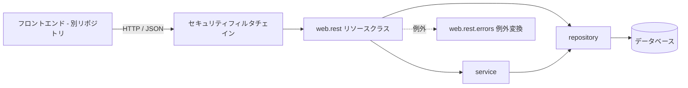
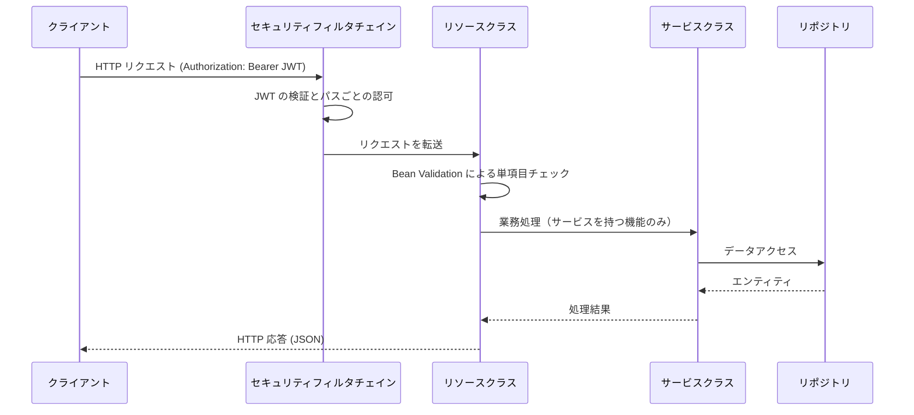

# 【JHipsterサンプルアプリ】アーキテクチャ設計書

## 改版履歴

| **版数（Ver）** | **版数（Rev）** | **改版日付** | **改版シート** | **改版内容** | **担当者** | **確認者** |
| --- | --- | --- | --- | --- | --- | --- |
| 1.0 |  | 2026/11/23 |  | 初版作成 |  |  |

---

## 目次

| 項番 | シート名 |
| --- | --- |
| 1 | 1　システム概要 |
| 2 | 2　全体構成 |
| 3 | 3　パッケージ構成と責務 |
| 4 | 4　レイヤ間の依存関係 |
| 5 | 5　アーキテクチャテスト |
| 6 | 6　リクエスト処理の流れ |
| 7 | 7　主要な技術構成 |
| 8 | 8　起動クラス |

---

## 1　システム概要

本システムは、JHipster 9.4.0 で生成したサンプルアプリケーション（銀行口座、ラベル、取引を管理する）を、モノリスからバックエンドとして切り出したものである。REST API（JSON）のみを提供し、画面は別リポジトリ `jhipster-sample-app-frontend` が担う。画面の組み込みや静的ファイルの配信は行わない（テスト `ApiOnlyIT` がこの挙動を確認している）。

| 項目 | 内容 |
| --- | --- |
| リポジトリ名 | `jhipster-sample-app-backend` |
| 実行基盤 | Spring Boot 4.1.1、Java 21 |
| ビルド | Maven（`pom.xml`） |
| 成果物 | 実行可能な JAR（`target/*.jar`） |
| アプリケーション名 | `jhipsterSampleApplication`（設定 `spring.application.name`） |
| 起動クラス | `JhipsterSampleApplicationApp` |
| ソースのルートパッケージ | `io.github.jhipster.sample` |

---

## 2　全体構成

| No | 構成要素 | パッケージ | 役割 |
| --- | --- | --- | --- |
| 1 | リソースクラス（REST 層） | `web.rest` | エンドポイント。リクエストの受け付け、単項目チェック、結果の応答 |
| 2 | サービス層 | `service` | ユーザとメールに関する業務処理 |
| 3 | リポジトリ層 | `repository` | データベースアクセス（Spring Data JPA） |
| 4 | ドメイン層 | `domain` | エンティティ |
| 5 | セキュリティ | `security` | 認証と認可の補助、現在ユーザの取得 |
| 6 | 設定 | `config` | Spring の設定クラス |
| 7 | 例外変換 | `web.rest.errors` | 例外をエラー応答に変換する |
| 8 | ログ | `aop.logging` | サービス、リポジトリ、リソースクラス（`web.rest`）の実行ログを出力するアスペクト |
| 9 | 監視 | `management` | JWT の検証エラーのメトリクス |

ユーザと権限に関する機能はリソースクラス → サービス → リポジトリの 3 段で構成する。銀行口座、取引、ラベル、権限の登録・更新・削除はサービスクラスを持たず、リソースクラスがリポジトリを直接使う。

---

## 3　パッケージ構成と責務

ルートパッケージ `io.github.jhipster.sample`（`src/main/java/io/github/jhipster/sample/`）配下は次のとおりである。

| No | パッケージ | 主なクラス | 責務 |
| --- | --- | --- | --- |
| 1 | （ルート） | `JhipsterSampleApplicationApp`、`ApplicationWebXml`、`GeneratedByJHipster` | アプリケーションの起動 |
| 2 | `config` | `SecurityConfiguration`、`SecurityJwtConfiguration`、`WebConfigurer`、`DatabaseConfiguration`、`LiquibaseConfiguration`、`CacheConfiguration`、`CacheKeyGeneratorConfiguration`、`AsyncConfiguration`、`LoggingConfiguration`、`LoggingAspectConfiguration`、`JacksonHibernateConfiguration`、`DateTimeFormatConfiguration`、`ApplicationProperties`、`Constants`、`CRLFLogConverter` | アプリケーションの設定 |
| 3 | `domain` | `User`、`Authority`、`BankAccount`、`Operation`、`Label`、`AbstractAuditingEntity` | ドメインオブジェクト（エンティティ） |
| 4 | `repository` | `UserRepository`、`AuthorityRepository`、`BankAccountRepository`、`OperationRepository`、`OperationRepositoryWithBagRelationships`、`OperationRepositoryWithBagRelationshipsImpl`、`LabelRepository` | リポジトリ層 |
| 5 | `service` | `UserService`、`MailService`、`EmailAlreadyUsedException`、`InvalidPasswordException`、`UsernameAlreadyUsedException` | サービス層 |
| 6 | `service.dto` | `AdminUserDTO`、`UserDTO`、`PasswordChangeDTO` | REST の入出力用の DTO |
| 7 | `service.mapper` | `UserMapper` | DTO のマッパー |
| 8 | `security` | `DomainUserDetailsService`、`SecurityUtils`、`AuthoritiesConstants`、`SpringSecurityAuditorAware`、`UserNotActivatedException` | セキュリティの補助 |
| 9 | `web.rest` | `AccountResource`、`AuthenticateController`、`UserResource`、`PublicUserResource`、`AuthorityResource`、`BankAccountResource`、`OperationResource`、`LabelResource` | REST 層 |
| 10 | `web.rest.errors` | `ExceptionTranslator`、`BadRequestAlertException`、`ErrorConstants`、`FieldErrorVM`、`EmailAlreadyUsedException`、`LoginAlreadyUsedException`、`InvalidPasswordException` | REST 層のエラー処理 |
| 11 | `web.rest.vm` | `LoginVM`、`ManagedUserVM`、`KeyAndPasswordVM` | REST 層のビューモデル |
| 12 | `aop.logging` | `LoggingAspect` | ログの出力アスペクト |
| 13 | `management` | `SecurityMetersService` | アプリケーションの監視 |

リソースは `src/main/resources/` 配下に置く。

| No | パス | 内容 |
| --- | --- | --- |
| 1 | `config/application.yml`、`config/application-{プロファイル}.yml` | プロファイル別の設定 |
| 2 | `config/liquibase/` | データベースの変更セットと初期データ |
| 3 | `i18n/messages.properties`、`i18n/messages_en.properties` | メッセージ |
| 4 | `templates/mail/*.html` | メールのテンプレート |
| 5 | `templates/error.html` | エラー画面のテンプレート |
| 6 | `logback-spring.xml` | ログの設定 |
| 7 | `config/tls/keystore.p12` | `tls` プロファイルで使う自己署名証明書 |

---

## 4　レイヤ間の依存関係

レイヤは 6 つに分け、依存の方向をアーキテクチャテストで制約している。依存とは、レイヤ間のすべての参照（インポート、メソッド呼び出し、継承など）である。

| レイヤ | 対応パッケージ | このレイヤを参照できるレイヤ |
| --- | --- | --- |
| Config | `..config..` | なし（どのレイヤからも参照不可） |
| Web | `..web..` | Config のみ |
| Service | `..service..` | Web、Config のみ |
| Security | `..security..` | Config、Service、Web のみ |
| Persistence | `..repository..` | Service、Security、Web、Config のみ |
| Domain | `..domain..` | Persistence、Service、Security、Web、Config のみ |

この制約から導かれる主な点は次のとおりである。

| No | 導かれる点 | 該当例 |
| --- | --- | --- |
| 1 | サービス層とリポジトリ層は、REST 層のクラスを参照できない | `UserService` は `web.rest` の例外クラスを使わず、`service` パッケージ内の同名の例外を返す（`ExceptionTranslator` が変換する） |
| 2 | REST 層はリポジトリを直接参照できる | `BankAccountResource`、`OperationResource`、`LabelResource`、`AuthorityResource`、`UserResource`、`AccountResource` はリポジトリを直接使う |
| 3 | ドメイン層はどのレイヤからも参照できる | エンティティは REST 層のリクエスト・応答本文としても使う |
| 4 | 設定クラスは他のレイヤから参照できない | 参照できるのは `config.Constants` と `config.ApplicationProperties` のみ |

`aop.logging` と `management` はどのレイヤにも属さない。`LoggingAspect` はポイントカットでパッケージ名を文字列として指定するため、依存関係には影響しない。`SecurityMetersService` は `config.SecurityJwtConfiguration` から参照される。

---

## 5　アーキテクチャテスト

| 項目 | 内容 |
| --- | --- |
| テストクラス | `TechnicalStructureTest` |
| ファイルパス（リポジトリルート基準） | `src/test/java/io/github/jhipster/sample/TechnicalStructureTest.java` |
| 使用ライブラリ | ArchUnit |
| 対象 | `JhipsterSampleApplicationApp` のパッケージ配下（テストコードを除く） |
| ルール名 | `respectsTechnicalArchitectureLayers` |

ルールは「4　レイヤ間の依存関係」の表のとおりである。次の依存はルールの対象外としている。

| No | 対象外とする依存 | 理由 |
| --- | --- | --- |
| 1 | 起動クラス `JhipsterSampleApplicationApp` から他への依存 | 起動クラスは設定クラスを参照するため |
| 2 | 各レイヤから `config.Constants`、`config.ApplicationProperties` への依存 | 全レイヤが共有する定数と設定のため |

Service と Persistence は「任意のレイヤ」（`optionalLayer`）として宣言しているため、クラスが存在しなくてもルールは成立する。

---

## 6　リクエスト処理の流れ

| No | 段階 | 内容 | 担当 |
| --- | --- | --- | --- |
| 1 | CORS | 設定がある場合、CORS のフィルタを通す | `WebConfigurer#corsFilter` |
| 2 | 認証 | `Authorization: Bearer` ヘッダの JWT を検証する | Spring Security（`SecurityJwtConfiguration#jwtDecoder`） |
| 3 | 認可（URL） | パスごとにアクセス可否を判定する | `SecurityConfiguration#filterChain` |
| 4 | 認可（メソッド） | `@PreAuthorize` により権限を判定する | `UserResource`、`AuthorityResource` |
| 5 | リクエストの変換とチェック | JSON を DTO またはエンティティに変換し、Bean Validation でチェックする | リソースクラス |
| 6 | 業務処理 | トランザクションの中で業務処理を行う | サービスクラス、またはリソースクラス |
| 7 | データアクセス | リポジトリでエンティティを検索、保存する | リポジトリ |
| 8 | 応答 | 結果を JSON に変換して返す | リソースクラス |
| 9 | 例外 | 例外を共通の形式のエラー応答に変換する | `ExceptionTranslator` |

いずれかの段階で例外が発生した場合、REST 層の中で発生した例外は `ExceptionTranslator` が受け取り、RFC 7807 形式のエラー応答に変換する。セキュリティフィルタチェインで拒否された場合は Spring Security が直接 401 または 403 を返す。詳細は「セキュリティ設計書」と「例外処理設計書」を参照。

---

## 7　主要な技術構成

`pom.xml` の主な依存関係は次のとおりである。

| No | 用途 | ライブラリ |
| --- | --- | --- |
| 1 | アプリケーション基盤 | Spring Boot 4.1.1（`spring-boot-starter`） |
| 2 | Web API | `spring-boot-starter-web`（Spring MVC）、`spring-boot-starter-validation` |
| 3 | セキュリティ | `spring-boot-starter-security`、`spring-boot-starter-oauth2-resource-server`、`spring-security-data` |
| 4 | データアクセス | `spring-boot-starter-data-jpa`（Hibernate）、`HikariCP` |
| 5 | データベース | `h2`（開発用、インメモリ）、`postgresql`（本番用） |
| 6 | スキーマ管理 | `spring-boot-starter-liquibase` |
| 7 | キャッシュ | `spring-boot-starter-cache`、`cache-api`、`ehcache`（`jakarta` 分類）、`hibernate-jcache` |
| 8 | JSON | `spring-boot-starter-jackson`、`jackson-datatype-hibernate7`、`jackson-module-jaxb-annotations` |
| 9 | メール | `spring-boot-starter-mail`、`spring-boot-starter-thymeleaf` |
| 10 | 監視 | `spring-boot-starter-actuator`、`micrometer-registry-prometheus` |
| 11 | アスペクト | `spring-boot-starter-aspectj` |
| 12 | API ドキュメント | `springdoc-openapi-starter-webmvc-api` 3.1.1 |
| 13 | 共通ユーティリティ | `jhipster-framework` 9.4.0、`commons-lang3` |
| 14 | マッパー | `mapstruct` 1.6.3（アノテーションプロセッサ） |
| 15 | アーキテクチャテスト | `archunit-junit5` 1.5.0（テストスコープ） |
| 16 | コンテナ | `jib-maven-plugin` 3.5.2（イメージのビルド） |

---

## 8　起動クラス

| No | クラス | ファイルパス（リポジトリルート基準） | 内容 |
| --- | --- | --- | --- |
| 1 | `JhipsterSampleApplicationApp` | `src/main/java/io/github/jhipster/sample/JhipsterSampleApplicationApp.java` | `main` メソッド。Spring Boot アプリケーションを起動する |
| 2 | `ApplicationWebXml` | `src/main/java/io/github/jhipster/sample/ApplicationWebXml.java` | サーブレットコンテナに WAR としてデプロイするときの入口（`SpringBootServletInitializer`） |
| 3 | `GeneratedByJHipster` | `src/main/java/io/github/jhipster/sample/GeneratedByJHipster.java` | 生成元を示すアノテーション（`Generated by JHipster 9.4.0`） |

`JhipsterSampleApplicationApp` の処理は次のとおりである。

| No | 処理 | 内容 |
| --- | --- | --- |
| 1 | 自動設定の除外 | `@SpringBootApplication(exclude = { H2ConsoleAutoConfiguration.class })`。H2 コンソールは `WebConfigurer` が独自に初期化する |
| 2 | 設定プロパティの有効化 | `@EnableConfigurationProperties({ LiquibaseProperties.class, ApplicationProperties.class })` |
| 3 | 起動時チェック | `initApplication`（`@PostConstruct`）。`dev` と `prod` の同時有効、`dev` と `cloud` の同時有効を検出し、エラーログを出力する |
| 4 | 既定プロファイルの設定 | `DefaultProfileUtil.addDefaultProfile(app)` |
| 5 | 起動ログ | `logApplicationStartup`。アプリケーション名、プロトコル、ポート、コンテキストパス、有効なプロファイルを出力する |

---
