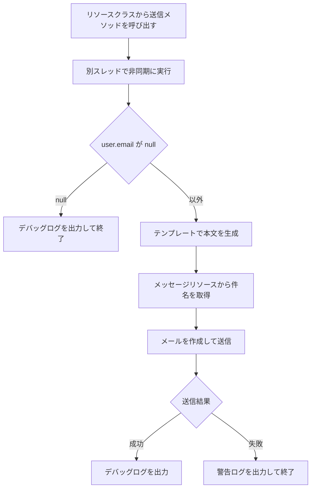

# 【JHipsterサンプルアプリ】メール送信設計書

## 改版履歴

| **版数（Ver）** | **版数（Rev）** | **改版日付** | **改版シート** | **改版内容** | **担当者** | **確認者** |
| --- | --- | --- | --- | --- | --- | --- |
| 1.0 |  | 2026/11/23 |  | 初版作成 |  |  |

---

## 目次

| 項番 | シート名 |
| --- | --- |
| 1 | 1　概要 |
| 2 | 2　メールの種類一覧 |
| 3 | 3　処理詳細 |
| 4 | 4　テンプレート |
| 5 | 5　設定 |
| 6 | 6　非同期実行 |
| 7 | 7　実装上の留意点 |

---

## 1　概要

メールは、アカウントの有効化、管理者によるユーザ作成の通知、パスワードリセットの 3 種類を送信する。送信はリクエストの処理とは別のスレッドで非同期に行う。

| No | クラス・ファイル | ファイルパス（リポジトリルート基準） | 役割 |
| --- | --- | --- | --- |
| 1 | `MailService` | `src/main/java/io/github/jhipster/sample/service/MailService.java` | メールの作成と送信 |
| 2 | `templates/mail/activationEmail.html` | `src/main/resources/templates/mail/activationEmail.html` | アカウント有効化メールのテンプレート |
| 3 | `templates/mail/creationEmail.html` | `src/main/resources/templates/mail/creationEmail.html` | 作成通知メールのテンプレート |
| 4 | `templates/mail/passwordResetEmail.html` | `src/main/resources/templates/mail/passwordResetEmail.html` | パスワードリセットメールのテンプレート |
| 5 | `i18n/messages.properties` | `src/main/resources/i18n/messages.properties` | 件名と本文のメッセージ |

| 項目 | 内容 |
| --- | --- |
| 送信の仕組み | Spring の `JavaMailSender`（SMTP） |
| 本文の生成 | Thymeleaf（`SpringTemplateEngine`） |
| メールの形式 | HTML（UTF-8、マルチパートなし） |
| 送信元 | 設定 `jhipster.mail.from` |

---

## 2　メールの種類一覧

| No | メソッド | テンプレート | 件名のメッセージキー | 本文に記載するリンク | 送信のタイミング | 宛先 |
| --- | --- | --- | --- | --- | --- | --- |
| 1 | `sendActivationEmail(User user)` | `mail/activationEmail` | `email.activation.title` | `{baseUrl}/account/activate?key={user.activationKey}` | `POST /api/register` の成功後（`AccountResource#registerAccount`） | `user.email` |
| 2 | `sendCreationEmail(User user)` | `mail/creationEmail` | `email.activation.title` | `{baseUrl}/account/reset/finish?key={user.resetKey}` | `POST /api/admin/users` の成功後（`UserResource#createUser`） | `user.email` |
| 3 | `sendPasswordResetMail(User user)` | `mail/passwordResetEmail` | `email.reset.title` | `{baseUrl}/account/reset/finish?key={user.resetKey}` | `POST /api/account/reset-password/init` で該当ユーザがあった場合（`AccountResource#requestPasswordReset`） | `user.email` |

リンクに含む `baseUrl` は設定 `jhipster.mail.base-url` であり、フロントエンド（別リポジトリ）のアドレスである。リンク先は本システムのエンドポイントではなく、フロントエンドのページである。

---

## 3　処理詳細

### 送信処理の流れ

### sendActivationEmail、sendCreationEmail、sendPasswordResetMail

3 つのメソッドは、テンプレート名と件名のメッセージキーが異なるだけで、処理は同じである。

#### １）デバッグログを出力する。

送信先のメールアドレスを含むデバッグログを出力してから、テンプレートによる送信処理を呼び出す。

#### ２）テンプレートで送信する。

| クラス | `MailService` |  |
| --- | --- | --- |
| メソッド | `sendEmailFromTemplateSync` |  |
| 引数 | 引数名 | 値 |
|  | parameter1 | `user` |
|  | parameter2 | テンプレート名（「2　メールの種類一覧」のとおり） |
|  | parameter3 | 件名のメッセージキー（同上） |
| 戻り値 | なし |  |

| No | 条件 | 処理 |
| --- | --- | --- |
| 1 | `user.getEmail()` が null | デバッグログ `Email doesn't exist for user '{login}'` を出力し、送信しない |
| 2 | 上記以外 | 下表のとおりロケールとテンプレートの変数を設定して本文を生成し、件名を取得して送信する |

| No | 項目 | 設定値 |
| --- | --- | --- |
| 1 | ロケール | `Locale.forLanguageTag(user.getLangKey())` |
| 2 | テンプレート変数 `user` | `user` |
| 3 | テンプレート変数 `baseUrl` | 設定 `jhipster.mail.base-url` の値 |
| 4 | 本文 | `templateEngine.process(テンプレート名, コンテキスト)` |
| 5 | 件名 | `messageSource.getMessage(件名のメッセージキー, null, ロケール)` |

### sendEmail（共通の送信処理）

`sendEmailFromTemplateSync` は `sendEmailSync` を呼び出す。`sendEmailSync(to, subject, content, isMultipart, isHtml)` の処理は次のとおりである。

| No | 処理 | 内容 |
| --- | --- | --- |
| 1 | メッセージの作成 | `MimeMessageHelper`（文字セットは UTF-8）で、宛先、送信元（`jhipster.mail.from`）、件名、本文を設定する。テンプレートからの呼び出しではマルチパートを `false`、HTML を `true` にする |
| 2 | 送信 | `javaMailSender.send(mimeMessage)` |
| 3 | 成功 | デバッグログ `Sent email to User '{}'` を出力する |
| 4 | 失敗 | `MailException` または `MessagingException` を捕捉し、警告ログ `Email could not be sent to user '{}'` を出力する。呼び出し元には例外を伝えない |

`MailService#sendEmail(String to, String subject, String content, boolean isMultipart, boolean isHtml)` は、テンプレートを使わずに本文を指定して送信する公開メソッドである。主コードからの呼び出し元はない。

---

## 4　テンプレート

3 つのテンプレートは同じ構造である。言語はロケールに従う。

| No | 部分 | 使うメッセージキーと変数 |
| --- | --- | --- |
| 1 | タイトル | `#{email.activation.title}`（有効化メールと作成通知メール）、`#{email.reset.title}`（リセットメール） |
| 2 | 挨拶 | `#{email.activation.greeting(${user.login})}` または `#{email.reset.greeting(${user.login})}` |
| 3 | 本文 | `#{email.activation.text1}`（有効化メール）、`#{email.creation.text1}`（作成通知メール）、`#{email.reset.text1}`（リセットメール） |
| 4 | リンク | 「2　メールの種類一覧」のリンク |
| 5 | 署名 | `#{email.activation.text2}` または `#{email.reset.text2}`、`#{email.signature}` |

メッセージの文言は「メッセージ」を参照。テンプレートは `user` の `login`、`activationKey`、`resetKey` だけを使い、遅延読み込みのプロパティ（権限など）は使わない。

---

## 5　設定

| No | キー | 説明 | `dev` | `prod` |
| --- | --- | --- | --- | --- |
| 1 | `spring.mail.host` | SMTP サーバのホスト | `localhost` | `localhost` |
| 2 | `spring.mail.port` | SMTP サーバのポート | `25` | `25` |
| 3 | `jhipster.mail.from` | 送信元のアドレス | `jhipsterSampleApplication@localhost`（共通設定） | 同左 |
| 4 | `jhipster.mail.base-url` | リンクの基底 URL（フロントエンドのアドレス） | `http://localhost:9060` | `http://my-server-url-to-change`（環境に合わせて変更する） |
| 5 | `spring.thymeleaf.cache` | テンプレートのキャッシュ | `false` | `true` |
| 6 | `spring.messages.cache-duration` | メッセージのキャッシュ期間 | `PT1S` | （未設定） |
| 7 | `management.health.mail.enabled` | メールのヘルスチェック | `false`（共通設定） | 同左 |

---

## 6　非同期実行

`MailService` の公開メソッドには `@Async` を付与している。呼び出すと、呼び出し元のリクエスト処理を待たずに、非同期処理用のスレッドプールで実行する。詳細は「非同期・定期処理設計書」を参照。

---

## 7　実装上の留意点

| No | 項目 | 内容 |
| --- | --- | --- |
| 1 | 送信失敗 | 送信に失敗してもリクエストの処理は成功扱いになる。失敗は警告ログで確認する |
| 2 | メールアドレスなし | `email` が null のユーザには送信しない（ユーザ登録では `email` の指定は必須ではない） |
| 3 | 作成通知メール | 管理者が作成したユーザの初期パスワードはランダムに生成したもので、メールには記載しない。代わりにリセットキー付きのリンクを記載し、利用者がパスワードを設定する |
| 4 | リセットキーの再利用 | 作成通知メールとパスワードリセットメールは、同じリンクの形式（`/account/reset/finish?key=...`）を使う。リセットキーの有効期限は、`resetDate` から 1 日である |
| 5 | 存在しないメールアドレス | パスワードリセットの要求でメールアドレスに該当するユーザがいない場合は送信しない |

---
