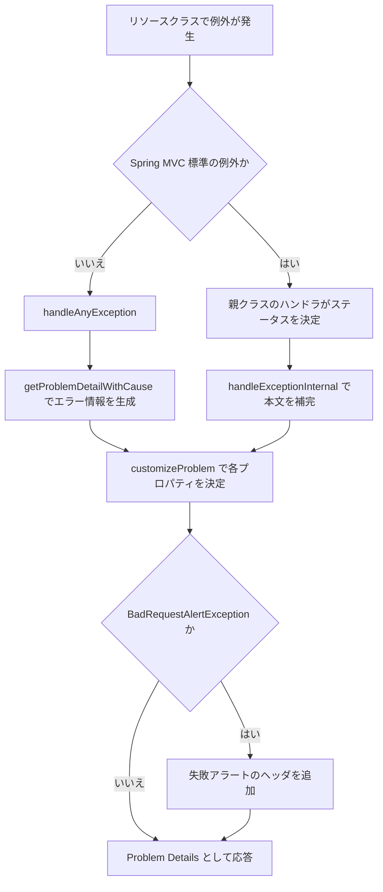

# 【JHipsterサンプルアプリ】例外処理設計書

## 改版履歴

| **版数（Ver）** | **版数（Rev）** | **改版日付** | **改版シート** | **改版内容** | **担当者** | **確認者** |
| --- | --- | --- | --- | --- | --- | --- |
| 1.0 |  | 2026/11/23 |  | 初版作成 |  |  |

---

## 目次

| 項番 | シート名 |
| --- | --- |
| 1 | 1　概要 |
| 2 | 2　エラー応答の形式 |
| 3 | 3　変換処理の流れ |
| 4 | 4　各プロパティの決定規則 |
| 5 | 5　例外とエラー応答の対応一覧 |
| 6 | 6　セキュリティフィルタチェインでの拒否 |
| 7 | 7　Problem Details 以外のエラー応答 |
| 8 | 8　エラー画面のテンプレート |

---

## 1　概要

REST 層で発生した例外は、共通のクラスで RFC 7807（Problem Details for HTTP APIs）形式の JSON に変換して応答する。

| 項目 | 内容 |
| --- | --- |
| クラス | `ExceptionTranslator` |
| ファイルパス（リポジトリルート基準） | `src/main/java/io/github/jhipster/sample/web/rest/errors/ExceptionTranslator.java` |
| 適用範囲 | すべてのリソースクラス（`@ControllerAdvice`） |
| 親クラス | `ResponseEntityExceptionHandler`（Spring MVC の標準の例外を処理する） |
| 応答の Content-Type | `application/problem+json` |
| 有効化 | 設定 `spring.mvc.problemdetails.enabled: true` |

エラー応答には、HTTP ステータスに加えてメッセージキー（`error.*`）を含める。文言は持たせず、フロントエンドがメッセージキーで文言を決める。

---

## 2　エラー応答の形式

| No | プロパティ | 内容 | 設定する条件 |
| --- | --- | --- | --- |
| 1 | `type` | エラー種別を表す URI（例 `https://www.jhipster.tech/problem/constraint-violation`） | 常に設定する |
| 2 | `title` | エラーの見出し | 常に設定する |
| 3 | `status` | HTTP ステータスコード | 常に設定する |
| 4 | `detail` | エラーの詳細 | 「4　各プロパティの決定規則」による |
| 5 | `message` | メッセージキー（例 `error.validation`） | 常に設定する |
| 6 | `path` | リクエストされた URI（例 `/api/register`） | 常に設定する |
| 7 | `fieldErrors` | 入力チェックエラーの明細の配列 | 入力チェックエラー（`MethodArgumentNotValidException`）の場合のみ |
| 8 | `params` | エンティティ名 | `BadRequestAlertException` の場合のみ |

`fieldErrors` の各要素は `FieldErrorVM`（`src/main/java/io/github/jhipster/sample/web/rest/errors/FieldErrorVM.java`）である。

| No | プロパティ | 内容 |
| --- | --- | --- |
| 1 | `objectName` | チェック対象のオブジェクト名。末尾が `DTO` の場合、その `DTO` を除いた値（例 `adminUserDTO` → `adminUser`） |
| 2 | `field` | エラーとなったフィールド名 |
| 3 | `message` | チェックのデフォルトメッセージ（英語）。ない場合はエラーコード |

形式の例を次に示す（`POST /api/operations` で `date` を省略した場合を想定し、変換規則から導いた例である。`detail` は省略する）。

```json
{
  "type": "https://www.jhipster.tech/problem/constraint-violation",
  "title": "Method argument not valid",
  "status": 400,
  "message": "error.validation",
  "path": "/api/operations",
  "fieldErrors": [
    { "objectName": "operation", "field": "date", "message": "must not be null" }
  ]
}
```

`must not be null` は `@NotNull` のデフォルトメッセージである（`ExceptionTranslatorIT#testMethodArgumentNotValid` が確認している）。

---

## 3　変換処理の流れ



### １）エラー情報の生成（getProblemDetailWithCause）

| No | 条件 | 生成するエラー情報 |
| --- | --- | --- |
| 1 | 例外が `service.UsernameAlreadyUsedException` | `web.rest.errors.LoginAlreadyUsedException` が持つエラー情報 |
| 2 | 例外が `service.EmailAlreadyUsedException` | `web.rest.errors.EmailAlreadyUsedException` が持つエラー情報 |
| 3 | 例外が `service.InvalidPasswordException` | `web.rest.errors.InvalidPasswordException` が持つエラー情報 |
| 4 | 例外が `ErrorResponseException` で、エラー情報が `ProblemDetailWithCause` | 例外が持つエラー情報をそのまま使う |
| 5 | 上記以外 | 新規に生成する（ステータスは「4」の規則で決定） |

No 1～3 により、サービス層は REST 層の例外クラスに依存せずに済む。

### ２）各プロパティの決定（customizeProblem）

「4　各プロパティの決定規則」を参照。

### ３）ヘッダの追加（buildHeaders）

発生した例外が `web.rest.errors.BadRequestAlertException`（またはそのサブクラス）である場合に限り、失敗アラートのヘッダを追加する。サービス層の例外（`service.UsernameAlreadyUsedException` 等）から変換した場合は、発生した例外が `BadRequestAlertException` ではないため、ヘッダは付かない。

| ヘッダ | 値 |
| --- | --- |
| `X-jhipsterSampleApplicationApp-error` | `message` と同じ値（例 `error.idexists`） |
| `X-jhipsterSampleApplicationApp-params` | `params` と同じ値（エンティティ名、URL エンコード済み） |

### ４）原因となった例外の連鎖

原因となった例外の連鎖をエラー応答に含めない（`CAUSAL_CHAIN_ENABLED` が `false`）。

---

## 4　各プロパティの決定規則

### status

上から順に判定し、最初に該当したものを採用する。

| No | 条件 | ステータス |
| --- | --- | --- |
| 1 | 例外が Spring の `ErrorResponse` を実装している（`ErrorResponseException` 等） | 例外が持つステータス |
| 2 | 例外が `AccessDeniedException` | 403 |
| 3 | 例外が `ConcurrencyFailureException` | 409 |
| 4 | 例外が `BadCredentialsException` | 401 |
| 5 | 例外が `ConstraintViolationException` | 400 |
| 6 | 例外のクラスに `@ResponseStatus` が付いている | アノテーションの値 |
| 7 | 上記以外 | 500 |

Spring MVC 標準の例外（ハンドラが親クラスにあるもの）は、親クラスのハンドラがステータスを決める。

### type

エラー情報の `type` が未設定または `about:blank` の場合は、次のとおり設定する。設定済みの場合は変えない。

| No | 条件 | `type`（略称） |
| --- | --- | --- |
| 1 | 例外が `MethodArgumentNotValidException` または `ConstraintViolationException` | `constraint-violation` |
| 2 | 上記以外 | `problem-with-message` |

### title

上から順に判定し、最初に該当したものを採用する。エラー情報に既に `title` があっても、この規則で決め直す。

| No | 条件 | `title` |
| --- | --- | --- |
| 1 | 例外が `MethodArgumentNotValidException` または `ConstraintViolationException` | `Method argument not valid` |
| 2 | 例外のクラスに `@ResponseStatus` の `reason` が付いている | `reason` の値（`AccountResourceException` は `Account resource request invalid`） |
| 3 | 上記以外 | HTTP ステータスの理由フレーズ（例 `Bad Request`、`Not Found`、`Internal Server Error`） |

### detail

エラー情報に `detail` が未設定の場合に、次のとおり設定する。

| No | 条件 | `detail` |
| --- | --- | --- |
| 1 | プロファイル `prod` で、例外が `HttpMessageConversionException` | `Unable to convert http message` |
| 2 | プロファイル `prod` で、例外が `DataAccessException` | `Failure during data access` |
| 3 | プロファイル `prod` で、例外のメッセージにパッケージ名の接頭辞（`org.`、`java.`、`net.`、`jakarta.`、`javax.`、`com.`、`io.`、`de.`、`io.github.jhipster.sample`）が含まれる | `Unexpected runtime exception` |
| 4 | 上記以外 | 原因の例外がある場合はそのメッセージ、ない場合は例外のメッセージ |

`prod` 以外では No 4 を適用する。

### message

エラー情報に `message` が未設定の場合に、次のとおり設定する。

| No | 条件 | `message` |
| --- | --- | --- |
| 1 | 例外が `MethodArgumentNotValidException` または `ConstraintViolationException` | `error.validation` |
| 2 | 例外（またはその原因）が `ConcurrencyFailureException` | `error.concurrencyFailure` |
| 3 | 上記以外 | `error.http.{status}` |

### path、fieldErrors

| No | プロパティ | 内容 |
| --- | --- | --- |
| 1 | `path` | リクエストの URI（`HttpServletRequest#getRequestURI`）。リクエストオブジェクト（`NativeWebRequest`）が null の場合は `about:blank`。リクエストオブジェクトから `HttpServletRequest` を取得できない場合は空の URI |
| 2 | `fieldErrors` | 例外が `MethodArgumentNotValidException` の場合、チェックエラーの一覧から生成する |

---

## 5　例外とエラー応答の対応一覧

| No | 例外 | 発生箇所 | ステータス | `type`（略称） | `message` | `params` | アラートヘッダ |
| --- | --- | --- | --- | --- | --- | --- | --- |
| 1 | `MethodArgumentNotValidException` | `@Valid` を付けたリクエスト本文のチェックエラー | 400 | `constraint-violation` | `error.validation` | － | － |
| 2 | `ConstraintViolationException` | メソッド引数のチェックエラー（`POST /api/account/reset-password/init`） | 400 | `constraint-violation` | `error.validation` | － | － |
| 3 | `web.rest.errors.BadRequestAlertException` | リソースクラスの ID チェック、権限の重複チェック | 400 | `problem-with-message` | `error.{エラーキー}` | エンティティ名 | あり |
| 4 | `web.rest.errors.LoginAlreadyUsedException` | `UserResource` | 400 | `login-already-used` | `error.userexists` | `userManagement` | あり |
| 5 | `web.rest.errors.EmailAlreadyUsedException` | `AccountResource`、`UserResource` | 400 | `email-already-used` | `error.emailexists` | `userManagement` | あり |
| 6 | `web.rest.errors.InvalidPasswordException` | `AccountResource` | 400 | `invalid-password` | `error.http.400` | － | － |
| 7 | `service.UsernameAlreadyUsedException`、`service.EmailAlreadyUsedException`、`service.InvalidPasswordException` | `UserService` | 400 | No 4～6 と同じ | No 4～6 と同じ | No 4～6 と同じ | なし |
| 8 | `AccountResourceException` | `AccountResource` | 400 | `problem-with-message` | `error.http.400` | － | － |
| 9 | `BadCredentialsException` | ログイン認証（`AuthenticateController#authorize`） | 401 | `problem-with-message` | `error.http.401` | － | － |
| 10 | `AccessDeniedException` | メソッドセキュリティ（`@PreAuthorize`） | 403 | `problem-with-message` | `error.http.403` | － | － |
| 11 | `ResponseStatusException` | `ResponseUtil#wrapOrNotFound`（検索結果なし） | 404 | `problem-with-message` | `error.http.404` | － | － |
| 12 | `ConcurrencyFailureException` | データアクセス | 409 | `problem-with-message` | `error.concurrencyFailure` | － | － |
| 13 | Spring MVC 標準の例外（サポートしない HTTP メソッド、必須パラメータの欠落等） | Spring MVC | Spring MVC が決定（405、400 等） | `problem-with-message` | `error.http.{status}` | － | － |
| 14 | `InternalAuthenticationServiceException`（原因は `security.UserNotActivatedException`） | ログイン認証（`DomainUserDetailsService` が `UserNotActivatedException` をスローし、Spring Security が包む） | 500 | `problem-with-message` | `error.http.500` | － | － |
| 15 | 上記以外の例外 | － | 500 | `problem-with-message` | `error.http.500` | － | － |

No 14 は動作確認済みである（2026/11/24、開発用の設定）。`UserNotActivatedException` には `@ResponseStatus` が付いておらず、それを包む `InternalAuthenticationServiceException` にもステータスを対応付ける規則がないため、No 15 の規則で 500 となる。応答の `detail` には `User <ログインID> was not activated` が入る。HTTP レベルでこれを確認する自動テストはない。

各例外の発生条件は、各機能の「サービス詳細設計書」のエラー一覧を参照。

---

## 6　セキュリティフィルタチェインでの拒否

セキュリティフィルタチェインで拒否されたリクエストは、リソースクラスに到達しないため `ExceptionTranslator` は関与しない。Spring Security が応答する。

| No | 発生条件 | ステータス | 応答本文 |
| --- | --- | --- | --- |
| 1 | 未認証、または JWT が無効 | 401 | なし |
| 2 | URL が要求する権限を持たない | 403 | なし |

詳細は「セキュリティ設計書」を参照。

---

## 7　Problem Details 以外のエラー応答

リソースクラスが例外をスローせず、直接エラーのステータスを返す箇所は、Problem Details にならない。

| No | 箇所 | ステータス | 応答本文 |
| --- | --- | --- | --- |
| 1 | `UserResource#getAllUsers`、`PublicUserResource#getAllPublicUsers`（許可されていないソートプロパティ） | 400 | なし |
| 2 | `AuthenticateController#isAuthenticated`（未認証） | 401 | なし |

---

## 8　エラー画面のテンプレート

| 項目 | 内容 |
| --- | --- |
| ファイル | `src/main/resources/templates/error.html` |
| 形式 | Thymeleaf の HTML テンプレート |
| 使うメッセージキー | `error.title`、`error.subtitle`、`error.status`、`error.message` |
| 表示する値 | `status`（ステータス）、`error`（エラー名）、`message`（メッセージ、空でない場合のみ） |

主コードにこのテンプレートを直接参照する箇所はない。REST API として JSON を要求するリクエストのエラーは「2　エラー応答の形式」で応答する。

---
