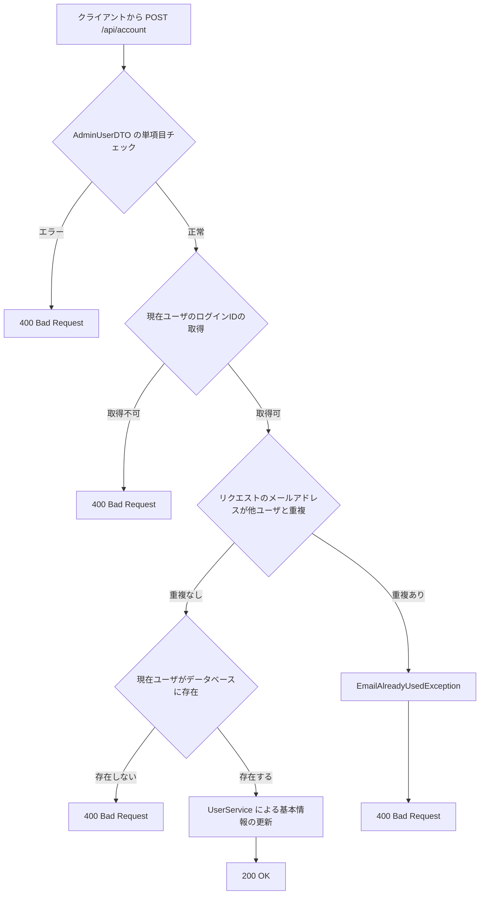

# 【JHipsterサンプルアプリ】サービス詳細設計書_アカウント情報取得・更新

## 改版履歴

| **版数（Ver）** | **版数（Rev）** | **改版日付** | **改版シート** | **改版内容** | **担当者** | **確認者** |
| --- | --- | --- | --- | --- | --- | --- |
| 1.0 |  | 2026/11/23 |  | 初版作成 |  |  |

---

## 目次

| サブシステム名(ID) | 機能ID | 機能日本語名 | 処理名 | 処理種別 |
| --- | --- | --- | --- | --- |
| JHipsterサンプルアプリ | AccountResource | アカウント情報取得・更新 |  | 参照・更新 |

目次

| 項番 | シート名 |
| --- | --- |
| 1 | 処理概要、処理フロー図 |
| 2 | 1　対象クラス |
| 3 | 2　API定義 |
| 4 | 3　単項目チェック |
| 5 | 4　相関項目チェック |
| 6 | 5　依存クラス |
| 7 | 6　処理詳細（GET /api/account） |
| 8 | 7　処理詳細（POST /api/account） |
| 9 | 8　エラー一覧 |

---

## 処理概要、処理フロー図

| サブシステム名(ID) | 機能ID | 機能日本語名 | 処理名 | 処理種別 |
| --- | --- | --- | --- | --- |
| JHipsterサンプルアプリ | AccountResource | アカウント情報取得・更新 |  | 参照・更新 |

### 処理概要

| ・ | ログイン中のユーザ自身のアカウント情報を取得する。 |
| --- | --- |
| ・ | ログイン中のユーザ自身の基本情報（名、姓、メールアドレス、言語、画像URL）を更新する。 |

コール元に対する補足説明

フロントエンド（別リポジトリ）が HTTP で呼び出す。対象ユーザは JWT のログインIDで特定し、リクエストでユーザを指定することはできない。

処理フロー図「アカウント情報更新（POST /api/account）」

---

## 1　対象クラス

| サブシステム名(ID) | 機能ID | 機能日本語名 | 処理名 | 処理種別 |
| --- | --- | --- | --- | --- |
| JHipsterサンプルアプリ | AccountResource | アカウント情報取得・更新 | 対象クラス | 参照・更新 |

### 処理詳細

| No | クラス | ファイルパス（リポジトリルート基準） | 役割 |
| --- | --- | --- | --- |
| 1 | `AccountResource` | `src/main/java/io/github/jhipster/sample/web/rest/AccountResource.java` | アカウント関連のエンドポイント |
| 2 | `AdminUserDTO` | `src/main/java/io/github/jhipster/sample/service/dto/AdminUserDTO.java` | リクエスト・応答の DTO |
| 3 | `UserService` | `src/main/java/io/github/jhipster/sample/service/UserService.java` | ユーザの参照と更新 |
| 4 | `UserRepository` | `src/main/java/io/github/jhipster/sample/repository/UserRepository.java` | ユーザテーブルへのアクセス |
| 5 | `SecurityUtils` | `src/main/java/io/github/jhipster/sample/security/SecurityUtils.java` | 現在ユーザのログインIDの取得 |
| 6 | `EmailAlreadyUsedException` | `src/main/java/io/github/jhipster/sample/web/rest/errors/EmailAlreadyUsedException.java` | メールアドレスの重複エラー |

---

## 2　API定義

| サブシステム名(ID) | 機能ID | 機能日本語名 | 処理名 | 処理種別 |
| --- | --- | --- | --- | --- |
| JHipsterサンプルアプリ | AccountResource | アカウント情報取得・更新 | API定義 | 参照・更新 |

### 処理詳細

| No | HTTPメソッド | URL | リソースクラス | メソッド | 認可 | リクエスト | 応答本文 | 正常時ステータス | トランザクション |
| --- | --- | --- | --- | --- | --- | --- | --- | --- | --- |
| 1 | GET | `/api/account` | AccountResource | `getAccount` | 認証済み | なし | `AdminUserDTO` | 200 | サービス層がトランザクションを管理する（読み取り専用） |
| 2 | POST | `/api/account` | AccountResource | `saveAccount` | 認証済み | `AdminUserDTO`（JSON） | なし | 200 | サービス層がトランザクションを管理する（読み書き） |

---

## 3　単項目チェック

| サブシステム名(ID) | 機能ID | 機能日本語名 | 処理名 | 処理種別 |
| --- | --- | --- | --- | --- |
| JHipsterサンプルアプリ | AccountResource | アカウント情報取得・更新 | 単項目チェック | 参照・更新 |

### 処理概要

リクエストデータ部の単項目チェックを実施する。

### 処理詳細

`POST /api/account` のみが対象である。チェックは `AdminUserDTO` の Bean Validation アノテーションで行う。項目とアノテーションは「SERVICE_DTO設計書_アカウント情報取得・更新」を参照。

チェックエラーの場合、業務エラーと返す。

---

## 4　相関項目チェック

| サブシステム名(ID) | 機能ID | 機能日本語名 | 処理名 | 処理種別 |
| --- | --- | --- | --- | --- |
| JHipsterサンプルアプリ | AccountResource | アカウント情報取得・更新 | 相関項目チェック | 参照・更新 |

### 処理概要

メールアドレスの一意性をチェックする。

### 処理詳細

#### １）メールアドレスの重複チェック

下記の条件で、`jhi_user` テーブルからデータを抽出する。

| 項番 | 取得テーブル名 | 取得メソッド | 取得条件 |
| --- | --- | --- | --- |
| 1 | `jhi_user` | `UserRepository#findOneByEmailIgnoreCase` | `jhi_user.email` ＝ リクエスト本文．`email`（大文字小文字を区別しない） |

結果判定

| 検索結果 | 正常/WARN/エラー | 応答 | 備考欄 |
| --- | --- | --- | --- |
| 0 件 | 正常 | － |  |
| 1 件あり、かつ抽出したユーザの `login` が現在ユーザのログインIDと同じ | 正常 | － | 自身のメールアドレスを変更せずに再送した場合。比較は `equalsIgnoreCase` で行う |
| 1 件あり、かつ抽出したユーザの `login` が現在ユーザのログインIDと異なる | 業務エラー | 400 | `EmailAlreadyUsedException` をスローする |

---

## 5　依存クラス

| サブシステム名(ID) | 機能ID | 機能日本語名 | 処理名 | 処理種別 |
| --- | --- | --- | --- | --- |
| JHipsterサンプルアプリ | AccountResource | アカウント情報取得・更新 | 依存クラス | 参照・更新 |

### 処理概要

コンストラクタインジェクションで、本クラスが使う次の Bean を注入する。

### 処理詳細

`AccountResource` のフィールドのうち、本機能で使うものは次のとおりである。

| No | クラス | フィールド | 用途 |
| --- | --- | --- | --- |
| 1 | `UserRepository` | `userRepository` | メールアドレスとログインIDによるユーザの検索 |
| 2 | `UserService` | `userService` | 現在ユーザの取得と基本情報の更新 |

`AccountResource` は `MailService` と `PasswordEncoder` も注入するが、本機能では使わない。

---

## 6　処理詳細（GET /api/account）

| サブシステム名(ID) | 機能ID | 機能日本語名 | 処理名 | 処理種別 |
| --- | --- | --- | --- | --- |
| JHipsterサンプルアプリ | AccountResource | アカウント情報取得・更新 | getAccount | 参照・更新 |

### 処理概要

現在ユーザのアカウント情報を、権限を含めて返す。

### 処理詳細

対象メソッドは `AccountResource#getAccount()` である。

#### １）現在ユーザを取得する。

| クラス | `UserService` |  |
| --- | --- | --- |
| メソッド | `getUserWithAuthorities` |  |
| 引数 | なし |  |
| 戻り値 | `Optional<User>` |  |

`UserService#getUserWithAuthorities` は `SecurityUtils.getCurrentUserLogin()` でログインIDを取得し、`UserRepository#findOneWithAuthoritiesByLogin` で権限（`authorities`）を同時に読み込んで検索する。

#### ２）結果判定

| 検索結果 | 正常/WARN/エラー | 応答 | 備考欄 |
| --- | --- | --- | --- |
| あり | 正常 | 200。`AdminUserDTO` のコンストラクタで `User` を変換した JSON を返す |  |
| なし | 業務エラー | 400 | `AccountResourceException("User could not be found")` をスローする |

---

## 7　処理詳細（POST /api/account）

| サブシステム名(ID) | 機能ID | 機能日本語名 | 処理名 | 処理種別 |
| --- | --- | --- | --- | --- |
| JHipsterサンプルアプリ | AccountResource | アカウント情報取得・更新 | saveAccount | 参照・更新 |

### 処理概要

現在ユーザの基本情報を更新する。

### 処理詳細

対象メソッドは `AccountResource#saveAccount(@Valid @RequestBody AdminUserDTO userDTO)` である。

#### １）現在ユーザのログインIDを取得する。

`SecurityUtils.getCurrentUserLogin()` の結果が空の場合、`AccountResourceException("Current user login not found")` をスローする（400）。

#### ２）メールアドレスの重複をチェックする。

「4　相関項目チェック」のとおり。重複する場合、`EmailAlreadyUsedException` をスローする（400）。

#### ３）現在ユーザの存在をチェックする。

`UserRepository#findOneByLogin(userLogin)` の結果が空の場合、`AccountResourceException("User could not be found")` をスローする（400）。

#### ４）基本情報を更新する。

| クラス | `UserService` |  |
| --- | --- | --- |
| メソッド | `updateUser` |  |
| 引数 | 引数名 | 値 |
|  | parameter1 | リクエスト本文．`firstName` |
|  | parameter2 | リクエスト本文．`lastName` |
|  | parameter3 | リクエスト本文．`email` |
|  | parameter4 | リクエスト本文．`langKey` |
|  | parameter5 | リクエスト本文．`imageUrl` |
| 戻り値 | なし |  |

`UserService#updateUser` は現在ユーザのログインIDで `User` を検索し、次の項目を設定して保存する。

| No | 編集項目 | 編集仕様 | 備考 |
| --- | --- | --- | --- |
| 1 | `firstName` | リクエスト本文．`firstName` |  |
| 2 | `lastName` | リクエスト本文．`lastName` |  |
| 3 | `email` | リクエスト本文．`email` を小文字化した値 | `email` が null の場合は更新しない |
| 4 | `langKey` | リクエスト本文．`langKey` |  |
| 5 | `imageUrl` | リクエスト本文．`imageUrl` |  |

保存後、ユーザのキャッシュを削除する（`UserService#clearUserCaches`）。リクエスト本文に `id`、`login`、`activated`、`authorities`、監査項目が含まれていても、本処理では使わない。

#### ５）応答を返す。

ステータス 200、応答本文なし。

---

## 8　エラー一覧

| サブシステム名(ID) | 機能ID | 機能日本語名 | 処理名 | 処理種別 |
| --- | --- | --- | --- | --- |
| JHipsterサンプルアプリ | AccountResource | アカウント情報取得・更新 | エラー一覧 | 参照・更新 |

### 処理詳細

エラー応答の本文は RFC 7807（Problem Details）形式である。変換規則は「01_共通仕様書 例外処理設計書」を参照。

| No | HTTPメソッド | 発生条件 | ステータス | `type` | `message` | 根拠 |
| --- | --- | --- | --- | --- | --- | --- |
| 1 | POST | `AdminUserDTO` の単項目チェックエラー | 400 | `constraint-violation` | `error.validation` | `AccountResourceIT#testSaveInvalidEmail` |
| 2 | POST | 現在ユーザのログインIDが取得できない | 400 | `problem-with-message` | `error.http.400` | コード（`AccountResourceException`） |
| 3 | POST | メールアドレスが他ユーザと重複 | 400 | `email-already-used` | `error.emailexists` | `AccountResourceIT#testSaveExistingEmail` |
| 4 | POST | 現在ユーザがデータベースに存在しない | 400 | `problem-with-message` | `error.http.400` | コード（`AccountResourceException`） |
| 5 | GET | 現在ユーザがデータベースに存在しない | 400 | `problem-with-message` | `error.http.400` | コード（`AccountResourceException`） |
| 6 | GET、POST | 未認証、または JWT が無効 | 401 | － | 本文なし | `AccountResourceIT#testGetUnknownAccount` |

---
