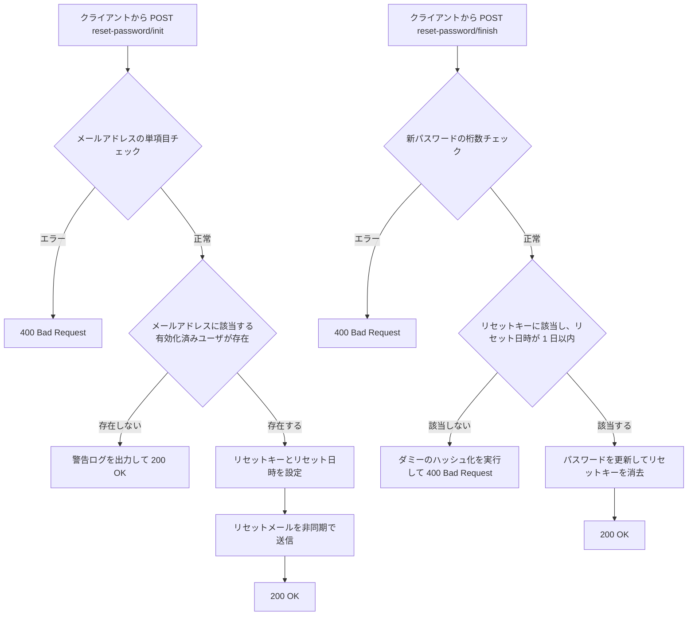

# 【JHipsterサンプルアプリ】サービス詳細設計書_パスワードリセット

## 改版履歴

| **版数（Ver）** | **版数（Rev）** | **改版日付** | **改版シート** | **改版内容** | **担当者** | **確認者** |
| --- | --- | --- | --- | --- | --- | --- |
| 1.0 |  | 2026/11/23 |  | 初版作成 |  |  |

---

## 目次

| サブシステム名(ID) | 機能ID | 機能日本語名 | 処理名 | 処理種別 |
| --- | --- | --- | --- | --- |
| JHipsterサンプルアプリ | AccountResource | パスワードリセット |  | 更新 |

目次

| 項番 | シート名 |
| --- | --- |
| 1 | 処理概要、処理フロー図 |
| 2 | 1　対象クラス |
| 3 | 2　API定義 |
| 4 | 3　単項目チェック |
| 5 | 4　依存クラス |
| 6 | 5　処理詳細（POST /api/account/reset-password/init） |
| 7 | 6　処理詳細（POST /api/account/reset-password/finish） |
| 8 | 7　エラー一覧 |

---

## 処理概要、処理フロー図

| サブシステム名(ID) | 機能ID | 機能日本語名 | 処理名 | 処理種別 |
| --- | --- | --- | --- | --- |
| JHipsterサンプルアプリ | AccountResource | パスワードリセット |  | 更新 |

### 処理概要

| ・ | 利用者がメールアドレスを指定してパスワードリセットを要求し、リセットキー付きのメールを受け取る。 |
| --- | --- |
| ・ | 利用者がリセットキーと新しいパスワードを指定して、パスワードを再設定する。 |

コール元に対する補足説明

両エンドポイントとも未認証で呼び出せる。リセットのメールに記載するリンクはフロントエンド（別リポジトリ）のページ `{baseUrl}/account/reset/finish?key={リセットキー}` である。

処理フロー図「パスワードリセット」

---

## 1　対象クラス

| サブシステム名(ID) | 機能ID | 機能日本語名 | 処理名 | 処理種別 |
| --- | --- | --- | --- | --- |
| JHipsterサンプルアプリ | AccountResource | パスワードリセット | 対象クラス | 更新 |

### 処理詳細

| No | クラス | ファイルパス（リポジトリルート基準） | 役割 |
| --- | --- | --- | --- |
| 1 | `AccountResource` | `src/main/java/io/github/jhipster/sample/web/rest/AccountResource.java` | エンドポイントと新パスワードの桁数チェック |
| 2 | `KeyAndPasswordVM` | `src/main/java/io/github/jhipster/sample/web/rest/vm/KeyAndPasswordVM.java` | リセット完了のリクエスト本文（VM） |
| 3 | `UserService` | `src/main/java/io/github/jhipster/sample/service/UserService.java` | リセットキーの発行とパスワードの再設定 |
| 4 | `MailService` | `src/main/java/io/github/jhipster/sample/service/MailService.java` | リセットメールの送信 |
| 5 | `UserRepository` | `src/main/java/io/github/jhipster/sample/repository/UserRepository.java` | ユーザテーブルへのアクセス |

---

## 2　API定義

| サブシステム名(ID) | 機能ID | 機能日本語名 | 処理名 | 処理種別 |
| --- | --- | --- | --- | --- |
| JHipsterサンプルアプリ | AccountResource | パスワードリセット | API定義 | 更新 |

### 処理詳細

| No | HTTPメソッド | URL | リソースクラス | メソッド | 認可 | リクエスト | 応答本文 | 正常時ステータス | トランザクション |
| --- | --- | --- | --- | --- | --- | --- | --- | --- | --- |
| 1 | POST | `/api/account/reset-password/init` | AccountResource | `requestPasswordReset` | 不要 | メールアドレスの文字列 | なし | 200 | サービス層がトランザクションを管理する（読み書き） |
| 2 | POST | `/api/account/reset-password/finish` | AccountResource | `finishPasswordReset` | 不要 | `KeyAndPasswordVM`（JSON） | なし | 200 | サービス層がトランザクションを管理する（読み書き） |

No 1 のリクエスト本文は JSON ではなく、メールアドレスの文字列そのものである（引用符を付けない）。

---

## 3　単項目チェック

| サブシステム名(ID) | 機能ID | 機能日本語名 | 処理名 | 処理種別 |
| --- | --- | --- | --- | --- |
| JHipsterサンプルアプリ | AccountResource | パスワードリセット | 単項目チェック | 更新 |

### 処理概要

リクエストデータ部の単項目チェックを実施する。

### 処理詳細

#### １）POST /api/account/reset-password/init

メールアドレスはメソッド引数で受け取り、引数に Bean Validation アノテーションを付けている。クラスレベルの `@Validated` により、このチェックが有効になる。

| No | 項目 | 型 | 必須 | 桁数 | アノテーション | 備考 |
| --- | --- | --- | --- | --- | --- | --- |
| 1 | `mail`（リクエスト本文） | String | ○ | 5～254 | `@Email`、`@Size(min = 5, max = 254)` |  |

チェックエラーの場合、`ConstraintViolationException` となり、業務エラー（400）を返す。

#### ２）POST /api/account/reset-password/finish

`KeyAndPasswordVM` には Bean Validation アノテーションがなく、メソッド引数も `@Valid` が付いていない。単項目チェックは `AccountResource#isPasswordLengthInvalid` による新パスワードの桁数チェックのみである。

| No | 項目 | 型 | 必須 | 桁数 | 備考 |
| --- | --- | --- | --- | --- | --- |
| 1 | `key` | String | ○ | － | チェックなし。null や誤りの値は、後段のリセットキーの検索で該当なしとなる |
| 2 | `newPassword` | String | ○ | 4～100 | 空文字、4 桁未満、101 桁以上の場合、業務エラー（400）を返す |

---

## 4　依存クラス

| サブシステム名(ID) | 機能ID | 機能日本語名 | 処理名 | 処理種別 |
| --- | --- | --- | --- | --- |
| JHipsterサンプルアプリ | AccountResource | パスワードリセット | 依存クラス | 更新 |

### 処理概要

コンストラクタインジェクションで、本クラスが使う次の Bean を注入する。

### 処理詳細

| No | クラス | フィールド | 用途 |
| --- | --- | --- | --- |
| 1 | `UserService` | `AccountResource#userService` | リセットキーの発行とパスワードの再設定 |
| 2 | `MailService` | `AccountResource#mailService` | リセットメールの送信 |
| 3 | `PasswordEncoder` | `AccountResource#passwordEncoder` | リセットキーが該当しない場合のダミーのハッシュ化 |
| 4 | `PasswordEncoder` | `UserService#passwordEncoder` | 新パスワードのハッシュ化 |

---

## 5　処理詳細（POST /api/account/reset-password/init）

| サブシステム名(ID) | 機能ID | 機能日本語名 | 処理名 | 処理種別 |
| --- | --- | --- | --- | --- |
| JHipsterサンプルアプリ | AccountResource | パスワードリセット | requestPasswordReset | 更新 |

### 処理概要

メールアドレスに該当する有効化済みユーザにリセットキーを発行し、リセットメールを送信する。

### 処理詳細

対象メソッドは `AccountResource#requestPasswordReset(@RequestBody @Email @Size(min = 5, max = 254) String mail)` である。

#### １）リセットキーを発行する。

| クラス | `UserService` |  |
| --- | --- | --- |
| メソッド | `requestPasswordReset` |  |
| 引数 | 引数名 | 値 |
|  | parameter1 | リクエスト本文（メールアドレス） |
| 戻り値 | `Optional<User>` |  |

`UserService#requestPasswordReset(mail)` の処理は次のとおりである。

| 項番 | 取得テーブル名 | 取得メソッド | 取得条件 |
| --- | --- | --- | --- |
| 1 | `jhi_user` | `UserRepository#findOneByEmailIgnoreCase` | `jhi_user.email` ＝ リクエスト本文（大文字小文字を区別しない） |

抽出したユーザの `activated` が true の場合のみ、次の項目を編集する。

| No | 編集項目 | 編集仕様 | 備考 |
| --- | --- | --- | --- |
| 1 | `resetKey` | `RandomUtil.generateResetKey()` | 20 桁の英数字 |
| 2 | `resetDate` | `Instant.now()` | リセットキーの有効期限の起点 |

編集後、`clearUserCaches` でユーザのキャッシュを削除する。

#### ２）結果判定

| 検索結果 | 正常/WARN/エラー | 応答 | 備考欄 |
| --- | --- | --- | --- |
| あり、かつ有効化済み | 正常 | リセットメールを送信し、200 |  |
| なし、または未有効化 | 正常 | 200 | メールアドレスの存在有無を応答から判別できないようにするため、警告ログ `Password reset requested for non existing mail` を出力して成功扱いとする。有効化済みユーザのみ対象とする点は `UserServiceIT#assertThatOnlyActivatedUserCanRequestPasswordReset` が確認している |

#### ３）リセットメールを送信する。

| クラス | `MailService` |  |
| --- | --- | --- |
| メソッド | `sendPasswordResetMail` |  |
| 引数 | 引数名 | 値 |
|  | parameter1 | 手順１）の `User` |
| 戻り値 | なし |  |

非同期で送信する。テンプレートは `mail/passwordResetEmail`、件名のメッセージキーは `email.reset.title` である。詳細は「01_共通仕様書 メール送信設計書」を参照。

#### ４）応答を返す。

ステータス 200、応答本文なし。

---

## 6　処理詳細（POST /api/account/reset-password/finish）

| サブシステム名(ID) | 機能ID | 機能日本語名 | 処理名 | 処理種別 |
| --- | --- | --- | --- | --- |
| JHipsterサンプルアプリ | AccountResource | パスワードリセット | finishPasswordReset | 更新 |

### 処理概要

リセットキーを検証し、新しいパスワードを登録する。

### 処理詳細

対象メソッドは `AccountResource#finishPasswordReset(@RequestBody KeyAndPasswordVM keyAndPassword)` である。

#### １）新パスワードの桁数をチェックする。

`isPasswordLengthInvalid(keyAndPassword.getNewPassword())` が true の場合、`web.rest.errors.InvalidPasswordException` をスローする（400）。

#### ２）パスワードを再設定する。

| クラス | `UserService` |  |
| --- | --- | --- |
| メソッド | `completePasswordReset` |  |
| 引数 | 引数名 | 値 |
|  | parameter1 | リクエスト本文．`newPassword` |
|  | parameter2 | リクエスト本文．`key` |
| 戻り値 | `Optional<User>` |  |

`UserService#completePasswordReset(newPassword, key)` の処理は次のとおりである。

| 項番 | 取得テーブル名 | 取得メソッド | 取得条件 |
| --- | --- | --- | --- |
| 1 | `jhi_user` | `UserRepository#findOneByResetKey` | `jhi_user.reset_key` ＝ リクエスト本文．`key` |

検索結果のうち、`resetDate` が現在日時の 1 日前より後である場合のみ、次の項目を編集する。

| No | 編集項目 | 編集仕様 | 備考 |
| --- | --- | --- | --- |
| 1 | `password` | `passwordEncoder.encode(newPassword)` | BCrypt のハッシュ |
| 2 | `resetKey` | `null` | 使用済みのリセットキーを無効化する |
| 3 | `resetDate` | `null` |  |

編集後、`clearUserCaches` でユーザのキャッシュを削除する。リセットキーの有効期限は、リセット要求の時点から 1 日である。

#### ３）結果判定

| 検索結果 | 正常/WARN/エラー | 応答 | 備考欄 |
| --- | --- | --- | --- |
| あり、かつリセット日時が 1 日以内 | 正常 | 200、応答本文なし |  |
| なし、またはリセット日時が 1 日を経過 | 業務エラー | 400 | ダミーの `passwordEncoder.encode(newPassword)` を実行してから、`AccountResourceException("No user was found for this reset key")` をスローする。有効期限については `UserServiceIT#assertThatResetKeyMustNotBeOlderThan24Hours` が確認している |

ダミーのハッシュ化は、リセットキーの有無で応答時間が変わることによる推測（タイミング攻撃）を防ぐ目的である。

---

## 7　エラー一覧

| サブシステム名(ID) | 機能ID | 機能日本語名 | 処理名 | 処理種別 |
| --- | --- | --- | --- | --- |
| JHipsterサンプルアプリ | AccountResource | パスワードリセット | エラー一覧 | 更新 |

### 処理詳細

エラー応答の本文は RFC 7807（Problem Details）形式である。変換規則は「01_共通仕様書 例外処理設計書」を参照。

| No | エンドポイント | 発生条件 | ステータス | `type` | `message` | 根拠 |
| --- | --- | --- | --- | --- | --- | --- |
| 1 | init | メールアドレスの形式または桁数のエラー | 400 | `constraint-violation` | `error.validation` | `AccountResourceIT#testRequestPasswordResetInvalidEmail`、`testRequestPasswordResetTooLongEmail` |
| 2 | init | メールアドレスに該当する有効化済みユーザがない | 200 | － | なし | `AccountResourceIT#testRequestPasswordResetWrongEmail` |
| 3 | finish | 新パスワードが空、4 桁未満、または 101 桁以上 | 400 | `invalid-password` | `error.http.400` | `AccountResourceIT#testFinishPasswordResetTooSmall` |
| 4 | finish | リセットキーに該当するユーザがない、またはリセット日時から 1 日を経過 | 400 | `problem-with-message` | `error.http.400` | `AccountResourceIT#testFinishPasswordResetWrongKey` |

---
