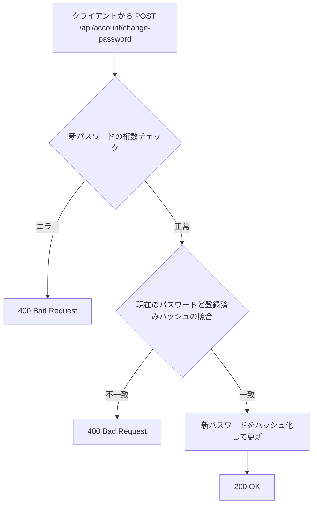

# 【JHipsterサンプルアプリ】サービス詳細設計書_パスワード変更

## 改版履歴

| **版数（Ver）** | **版数（Rev）** | **改版日付** | **改版シート** | **改版内容** | **担当者** | **確認者** |
| --- | --- | --- | --- | --- | --- | --- |
| 1.0 |  | 2026/11/23 |  | 初版作成 |  |  |

---

## 目次

| サブシステム名(ID) | 機能ID | 機能日本語名 | 処理名 | 処理種別 |
| --- | --- | --- | --- | --- |
| JHipsterサンプルアプリ | AccountResource | パスワード変更 |  | 更新 |

目次

| 項番 | シート名 |
| --- | --- |
| 1 | 処理概要、処理フロー図 |
| 2 | 1　対象クラス |
| 3 | 2　API定義 |
| 4 | 3　単項目チェック |
| 5 | 4　相関項目チェック |
| 6 | 5　依存クラス |
| 7 | 6　処理詳細 |
| 8 | 7　エラー一覧 |

---

## 処理概要、処理フロー図

| サブシステム名(ID) | 機能ID | 機能日本語名 | 処理名 | 処理種別 |
| --- | --- | --- | --- | --- |
| JHipsterサンプルアプリ | AccountResource | パスワード変更 |  | 更新 |

### 処理概要

| ・ | ログイン中のユーザが、現在のパスワードを提示して、自身のパスワードを変更する。 |
| --- | --- |

コール元に対する補足説明

フロントエンド（別リポジトリ）が HTTP で呼び出す。対象ユーザは JWT のログインIDで特定し、リクエストでユーザを指定することはできない。

処理フロー図「パスワード変更（POST /api/account/change-password）」

---

## 1　対象クラス

| サブシステム名(ID) | 機能ID | 機能日本語名 | 処理名 | 処理種別 |
| --- | --- | --- | --- | --- |
| JHipsterサンプルアプリ | AccountResource | パスワード変更 | 対象クラス | 更新 |

### 処理詳細

| No | クラス | ファイルパス（リポジトリルート基準） | 役割 |
| --- | --- | --- | --- |
| 1 | `AccountResource` | `src/main/java/io/github/jhipster/sample/web/rest/AccountResource.java` | エンドポイントと新パスワードの桁数チェック |
| 2 | `PasswordChangeDTO` | `src/main/java/io/github/jhipster/sample/service/dto/PasswordChangeDTO.java` | リクエスト本文（DTO） |
| 3 | `ManagedUserVM` | `src/main/java/io/github/jhipster/sample/web/rest/vm/ManagedUserVM.java` | パスワードの桁数の定義（`PASSWORD_MIN_LENGTH`、`PASSWORD_MAX_LENGTH`） |
| 4 | `UserService` | `src/main/java/io/github/jhipster/sample/service/UserService.java` | パスワードの照合と更新 |
| 5 | `InvalidPasswordException` | `src/main/java/io/github/jhipster/sample/service/InvalidPasswordException.java` | 現在のパスワード不一致の例外 |
| 6 | `InvalidPasswordException` | `src/main/java/io/github/jhipster/sample/web/rest/errors/InvalidPasswordException.java` | 桁数エラーの例外。エラー応答の定義も兼ねる |

---

## 2　API定義

| サブシステム名(ID) | 機能ID | 機能日本語名 | 処理名 | 処理種別 |
| --- | --- | --- | --- | --- |
| JHipsterサンプルアプリ | AccountResource | パスワード変更 | API定義 | 更新 |

### 処理詳細

| No | HTTPメソッド | URL | リソースクラス | メソッド | 認可 | リクエスト | 応答本文 | 正常時ステータス | トランザクション |
| --- | --- | --- | --- | --- | --- | --- | --- | --- | --- |
| 1 | POST | `/api/account/change-password` | AccountResource | `changePassword` | 認証済み | `PasswordChangeDTO`（JSON） | なし | 200 | サービス層がトランザクションを管理する（読み書き） |

---

## 3　単項目チェック

| サブシステム名(ID) | 機能ID | 機能日本語名 | 処理名 | 処理種別 |
| --- | --- | --- | --- | --- |
| JHipsterサンプルアプリ | AccountResource | パスワード変更 | 単項目チェック | 更新 |

### 処理概要

リクエストデータ部の単項目チェックを実施する。チェックはアノテーションではなく、リソースクラス内のコードで行う。

### 処理詳細

`PasswordChangeDTO` には Bean Validation アノテーションがなく、メソッド引数も `@Valid` が付いていない。単項目チェックは `AccountResource#isPasswordLengthInvalid` による新パスワードの桁数チェックのみである。

| No | 項目 | 型 | 必須 | 桁数 | 備考 |
| --- | --- | --- | --- | --- | --- |
| 1 | `currentPassword` | String | － | － | チェックなし。null の場合、後段の照合で不一致となる |
| 2 | `newPassword` | String | ○ | 4～100 | `newPassword` が空文字、4 桁未満、または 101 桁以上の場合、業務エラー（400）を返す |

桁数の下限と上限は `ManagedUserVM.PASSWORD_MIN_LENGTH`（4）と `ManagedUserVM.PASSWORD_MAX_LENGTH`（100）である。

---

## 4　相関項目チェック

| サブシステム名(ID) | 機能ID | 機能日本語名 | 処理名 | 処理種別 |
| --- | --- | --- | --- | --- |
| JHipsterサンプルアプリ | AccountResource | パスワード変更 | 相関項目チェック | 更新 |

### 処理概要

現在のパスワードが登録済みのハッシュと一致することをチェックする。

### 処理詳細

| No | チェック | 結果 |
| --- | --- | --- |
| 1 | リクエスト本文．`currentPassword` と `jhi_user.password_hash` の照合（`PasswordEncoder#matches`） | 不一致の場合、`InvalidPasswordException` をスローし、業務エラー（400）とする |

---

## 5　依存クラス

| サブシステム名(ID) | 機能ID | 機能日本語名 | 処理名 | 処理種別 |
| --- | --- | --- | --- | --- |
| JHipsterサンプルアプリ | AccountResource | パスワード変更 | 依存クラス | 更新 |

### 処理概要

コンストラクタインジェクションで、本クラスが使う次の Bean を注入する。

### 処理詳細

`AccountResource` のフィールドのうち、本機能で使うものは次のとおりである。

| No | クラス | フィールド | 用途 |
| --- | --- | --- | --- |
| 1 | `UserService` | `userService` | パスワードの照合と更新 |

`UserRepository#save` は `JpaRepository` から継承したメソッドであり、リポジトリのインターフェースには宣言がない。

---

## 6　処理詳細

| サブシステム名(ID) | 機能ID | 機能日本語名 | 処理名 | 処理種別 |
| --- | --- | --- | --- | --- |
| JHipsterサンプルアプリ | AccountResource | パスワード変更 | changePassword | 更新 |

### 処理概要

現在のパスワードを検証し、新しいパスワードを登録する。

### 処理詳細

対象メソッドは `AccountResource#changePassword(@RequestBody PasswordChangeDTO passwordChangeDto)` である。

#### １）新パスワードの桁数をチェックする。

`isPasswordLengthInvalid(passwordChangeDto.getNewPassword())` が true の場合、`web.rest.errors.InvalidPasswordException` をスローする（400）。

#### ２）パスワードを変更する。

| クラス | `UserService` |  |
| --- | --- | --- |
| メソッド | `changePassword` |  |
| 引数 | 引数名 | 値 |
|  | parameter1 | リクエスト本文．`currentPassword` |
|  | parameter2 | リクエスト本文．`newPassword` |
| 戻り値 | なし |  |

`UserService#changePassword(currentClearTextPassword, newPassword)` の処理は次のとおりである。

| No | 条件 | 処理 | 結果 |
| --- | --- | --- | --- |
| 1 | 現在ユーザのログインIDで `UserRepository#findOneByLogin` を検索し、結果がない | 何もしない | 200 のまま |
| 2 | 結果があり、`passwordEncoder.matches(currentClearTextPassword, user.getPassword())` が false | `service.InvalidPasswordException` をスローする | 400 |
| 3 | 結果があり、照合が一致 | `passwordEncoder.encode(newPassword)` を `password` に設定し、`UserRepository#save` で保存する | 200 |

保存後、ユーザのキャッシュを削除する（`UserService#clearUserCaches`）。ハッシュ化の方式は `BCryptPasswordEncoder` である。ハッシュは 60 桁の文字列で、`jhi_user.password_hash`（varchar(60)）に格納する。

#### ３）応答を返す。

ステータス 200、応答本文なし。

---

## 7　エラー一覧

| サブシステム名(ID) | 機能ID | 機能日本語名 | 処理名 | 処理種別 |
| --- | --- | --- | --- | --- |
| JHipsterサンプルアプリ | AccountResource | パスワード変更 | エラー一覧 | 更新 |

### 処理詳細

エラー応答の本文は RFC 7807（Problem Details）形式である。変換規則は「01_共通仕様書 例外処理設計書」を参照。

| No | 発生条件 | ステータス | `type` | `message` | 根拠 |
| --- | --- | --- | --- | --- | --- |
| 1 | 新パスワードが空、4 桁未満、または 101 桁以上 | 400 | `invalid-password` | `error.http.400` | `AccountResourceIT#testChangePasswordEmpty`、`testChangePasswordTooSmall`、`testChangePasswordTooLong` |
| 2 | 現在のパスワードが不一致 | 400 | `invalid-password` | `error.http.400` | `AccountResourceIT#testChangePasswordWrongExistingPassword` |
| 3 | 未認証、または JWT が無効 | 401 | － | 本文なし | コード（`SecurityConfiguration`） |

---
