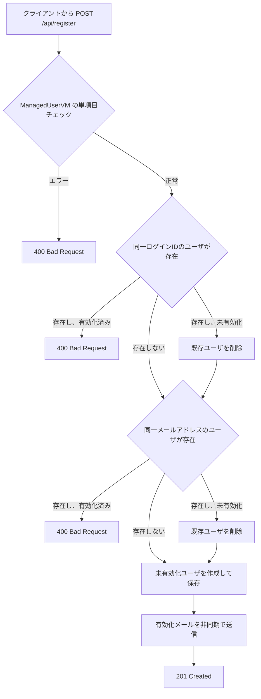

# 【JHipsterサンプルアプリ】サービス詳細設計書_ユーザ登録・アカウント有効化

## 改版履歴

| **版数（Ver）** | **版数（Rev）** | **改版日付** | **改版シート** | **改版内容** | **担当者** | **確認者** |
| --- | --- | --- | --- | --- | --- | --- |
| 1.0 |  | 2026/11/23 |  | 初版作成 |  |  |

---

## 目次

| サブシステム名(ID) | 機能ID | 機能日本語名 | 処理名 | 処理種別 |
| --- | --- | --- | --- | --- |
| JHipsterサンプルアプリ | AccountResource | ユーザ登録・アカウント有効化 |  | 登録・更新 |

目次

| 項番 | シート名 |
| --- | --- |
| 1 | 処理概要、処理フロー図 |
| 2 | 1　対象クラス |
| 3 | 2　API定義 |
| 4 | 3　単項目チェック |
| 5 | 4　相関項目チェック |
| 6 | 5　依存クラス |
| 7 | 6　処理詳細（POST /api/register） |
| 8 | 7　処理詳細（GET /api/activate） |
| 9 | 8　エラー一覧 |

---

## 処理概要、処理フロー図

| サブシステム名(ID) | 機能ID | 機能日本語名 | 処理名 | 処理種別 |
| --- | --- | --- | --- | --- |
| JHipsterサンプルアプリ | AccountResource | ユーザ登録・アカウント有効化 |  | 登録・更新 |

### 処理概要

| ・ | 未認証の利用者が、ログインID、パスワード、メールアドレスを指定してユーザを登録する。 |
| --- | --- |
| ・ | 登録したユーザは未有効化の状態で作成される。利用者は、メールで通知された有効化キーでアカウントを有効化する。 |

コール元に対する補足説明

両エンドポイントとも未認証で呼び出せる。有効化のメールに記載するリンクはフロントエンド（別リポジトリ）のページ `{baseUrl}/account/activate?key={有効化キー}` である。

処理フロー図「ユーザ登録（POST /api/register）」

---

## 1　対象クラス

| サブシステム名(ID) | 機能ID | 機能日本語名 | 処理名 | 処理種別 |
| --- | --- | --- | --- | --- |
| JHipsterサンプルアプリ | AccountResource | ユーザ登録・アカウント有効化 | 対象クラス | 登録・更新 |

### 処理詳細

| No | クラス | ファイルパス（リポジトリルート基準） | 役割 |
| --- | --- | --- | --- |
| 1 | `AccountResource` | `src/main/java/io/github/jhipster/sample/web/rest/AccountResource.java` | エンドポイントとパスワードの桁数チェック |
| 2 | `ManagedUserVM` | `src/main/java/io/github/jhipster/sample/web/rest/vm/ManagedUserVM.java` | 登録のリクエスト本文（VM） |
| 3 | `UserService` | `src/main/java/io/github/jhipster/sample/service/UserService.java` | ユーザの登録と有効化 |
| 4 | `MailService` | `src/main/java/io/github/jhipster/sample/service/MailService.java` | 有効化メールの送信 |
| 5 | `UserRepository` | `src/main/java/io/github/jhipster/sample/repository/UserRepository.java` | ユーザテーブルへのアクセス |
| 6 | `AuthorityRepository` | `src/main/java/io/github/jhipster/sample/repository/AuthorityRepository.java` | 権限の取得 |
| 7 | `UsernameAlreadyUsedException` | `src/main/java/io/github/jhipster/sample/service/UsernameAlreadyUsedException.java` | ログインIDの重複エラー（サービス層） |
| 8 | `EmailAlreadyUsedException` | `src/main/java/io/github/jhipster/sample/service/EmailAlreadyUsedException.java` | メールアドレスの重複エラー（サービス層） |

---

## 2　API定義

| サブシステム名(ID) | 機能ID | 機能日本語名 | 処理名 | 処理種別 |
| --- | --- | --- | --- | --- |
| JHipsterサンプルアプリ | AccountResource | ユーザ登録・アカウント有効化 | API定義 | 登録・更新 |

### 処理詳細

| No | HTTPメソッド | URL | リソースクラス | メソッド | 認可 | リクエスト | 応答本文 | 正常時ステータス | トランザクション |
| --- | --- | --- | --- | --- | --- | --- | --- | --- | --- |
| 1 | POST | `/api/register` | AccountResource | `registerAccount` | 不要 | 本文 `ManagedUserVM`（JSON） | なし | 201 | サービス層がトランザクションを管理する（読み書き） |
| 2 | GET | `/api/activate` | AccountResource | `activateAccount` | 不要 | クエリパラメータ `key`（必須） | なし | 200 | サービス層がトランザクションを管理する（読み書き） |

---

## 3　単項目チェック

| サブシステム名(ID) | 機能ID | 機能日本語名 | 処理名 | 処理種別 |
| --- | --- | --- | --- | --- |
| JHipsterサンプルアプリ | AccountResource | ユーザ登録・アカウント有効化 | 単項目チェック | 登録・更新 |

### 処理概要

リクエストデータ部の単項目チェックを実施する。

### 処理詳細

`POST /api/register` のみが対象である。チェックは `ManagedUserVM` の Bean Validation アノテーションと、リソースクラス内のパスワードの桁数チェックで行う。

| No | 項目 | 型 | 必須 | 桁数 | アノテーション | 備考 |
| --- | --- | --- | --- | --- | --- | --- |
| 1 | `login` | String | ○ | 1～50 | `@NotBlank`、`@Pattern(regexp = Constants.LOGIN_REGEX)`、`@Size(min = 1, max = 50)` | 使用できる文字は `Constants.LOGIN_REGEX` で定義する |
| 2 | `password` | String | ○ | 4～100 | `@Size(min = 4, max = 100)` | 空、4 桁未満、101 桁以上の場合はリソースクラスのコードでも 400 とする |
| 3 | `firstName` | String | － | 50 以内 | `@Size(max = 50)` |  |
| 4 | `lastName` | String | － | 50 以内 | `@Size(max = 50)` |  |
| 5 | `email` | String | － | 5～254 | `@Email`、`@Size(min = 5, max = 254)` | 値がある場合のみチェックする |
| 6 | `imageUrl` | String | － | 256 以内 | `@Size(max = 256)` |  |
| 7 | `langKey` | String | － | 2～10 | `@Size(min = 2, max = 10)` |  |

`id`、`activated`、`authorities`、監査項目（`createdBy` 等）はチェックの対象外であり、登録処理でも使わない。

チェックエラーの場合、業務エラーと返す。

---

## 4　相関項目チェック

| サブシステム名(ID) | 機能ID | 機能日本語名 | 処理名 | 処理種別 |
| --- | --- | --- | --- | --- |
| JHipsterサンプルアプリ | AccountResource | ユーザ登録・アカウント有効化 | 相関項目チェック | 登録・更新 |

### 処理概要

ログインIDとメールアドレスの一意性をチェックする。

### 処理詳細

チェックは `UserService#registerUser` の中で行う。

#### １）ログインIDの重複チェック

| 項番 | 取得テーブル名 | 取得メソッド | 取得条件 |
| --- | --- | --- | --- |
| 1 | `jhi_user` | `UserRepository#findOneByLogin` | `jhi_user.login` ＝ リクエスト本文．`login` を小文字化した値 |

結果判定

| 検索結果 | 正常/WARN/エラー | 応答 | 備考欄 |
| --- | --- | --- | --- |
| 0 件 | 正常 | － | 登録を続行する |
| あり、抽出したユーザが有効化済み | 業務エラー | 400 | `service.UsernameAlreadyUsedException` をスローする |
| あり（未有効化のユーザ） | 正常 | － | 抽出したユーザを削除し、登録を続行する（`UserService#removeNonActivatedUser`） |

#### ２）メールアドレスの重複チェック

| 項番 | 取得テーブル名 | 取得メソッド | 取得条件 |
| --- | --- | --- | --- |
| 1 | `jhi_user` | `UserRepository#findOneByEmailIgnoreCase` | `jhi_user.email` ＝ リクエスト本文．`email`（大文字小文字を区別しない） |

結果判定はログインIDと同じである。有効化済みのユーザが存在する場合、`service.EmailAlreadyUsedException` をスローし、400 とする。

---

## 5　依存クラス

| サブシステム名(ID) | 機能ID | 機能日本語名 | 処理名 | 処理種別 |
| --- | --- | --- | --- | --- |
| JHipsterサンプルアプリ | AccountResource | ユーザ登録・アカウント有効化 | 依存クラス | 登録・更新 |

### 処理概要

コンストラクタインジェクションで、本クラスが使う次の Bean を注入する。

### 処理詳細

| No | クラス | フィールド | 用途 |
| --- | --- | --- | --- |
| 1 | `UserService` | `AccountResource#userService` | ユーザの登録と有効化 |
| 2 | `MailService` | `AccountResource#mailService` | 有効化メールの送信 |
| 3 | `UserRepository` | `UserService#userRepository` | 重複チェックと保存 |
| 4 | `AuthorityRepository` | `UserService#authorityRepository` | 登録時に付与する権限 `ROLE_USER` の取得 |
| 5 | `PasswordEncoder` | `UserService#passwordEncoder` | パスワードのハッシュ化 |
| 6 | `CacheManager` | `UserService#cacheManager` | キャッシュの削除 |

`UserRepository` の `save`、`delete`、`flush` は、`JpaRepository` から継承したメソッドである。リポジトリのインターフェースには宣言がない。

---

## 6　処理詳細（POST /api/register）

| サブシステム名(ID) | 機能ID | 機能日本語名 | 処理名 | 処理種別 |
| --- | --- | --- | --- | --- |
| JHipsterサンプルアプリ | AccountResource | ユーザ登録・アカウント有効化 | registerAccount | 登録・更新 |

### 処理概要

未有効化のユーザを作成し、有効化メールを送信する。

### 処理詳細

対象メソッドは `AccountResource#registerAccount(@Valid @RequestBody ManagedUserVM managedUserVM)` である。

#### １）パスワードの桁数をチェックする。

`isPasswordLengthInvalid(managedUserVM.getPassword())` が true の場合、`web.rest.errors.InvalidPasswordException` をスローする（400）。

#### ２）ユーザを登録する。

| クラス | `UserService` |  |
| --- | --- | --- |
| メソッド | `registerUser` |  |
| 引数 | 引数名 | 値 |
|  | parameter1 | リクエスト本文（`ManagedUserVM`） |
|  | parameter2 | リクエスト本文．`password` |
| 戻り値 | `User` | 登録したユーザ |

`UserService#registerUser(AdminUserDTO userDTO, String password)` の処理は次のとおりである。

| No | 処理 | 備考 |
| --- | --- | --- |
| 1 | 「4　相関項目チェック」のとおりに、ログインIDとメールアドレスの重複をチェックする | エラーの場合は登録しない |
| 2 | 新規に `User` を生成し、下表の項目を編集する |  |
| 3 | `UserRepository#save` で保存する | 監査項目は `AuditingEntityListener` が設定する |
| 4 | `clearUserCaches` でユーザのキャッシュを削除する |  |

`User` の編集仕様

| No | 編集項目 | 編集仕様 | 備考 |
| --- | --- | --- | --- |
| 1 | `login` | リクエスト本文．`login` を `toLowerCase` で小文字化した値 |  |
| 2 | `password` | `passwordEncoder.encode(リクエスト本文．password)` | BCrypt のハッシュ |
| 3 | `firstName` | リクエスト本文．`firstName` |  |
| 4 | `lastName` | リクエスト本文．`lastName` |  |
| 5 | `email` | リクエスト本文．`email` を小文字化した値 | `email` が null の場合は設定しない |
| 6 | `imageUrl` | リクエスト本文．`imageUrl` |  |
| 7 | `langKey` | リクエスト本文．`langKey` |  |
| 8 | `activated` | `false` | 未有効化で作成する |
| 9 | `activationKey` | `RandomUtil.generateActivationKey()` | 20 桁の英数字 |
| 10 | `authorities` | `ROLE_USER` のみ | `AuthorityRepository#findById(AuthoritiesConstants.USER)` で取得する。リクエスト本文．`authorities` は無視する（`AccountResourceIT#testRegisterAdminIsIgnored`） |

登録者（`created_by`）は `SpringSecurityAuditorAware` が設定する。本エンドポイントは未認証のため、値は `Constants.SYSTEM`（`system`）となる。

#### ３）有効化メールを送信する。

| クラス | `MailService` |  |
| --- | --- | --- |
| メソッド | `sendActivationEmail` |  |
| 引数 | 引数名 | 値 |
|  | parameter1 | 手順２）で登録した `User` |
| 戻り値 | なし |  |

非同期で送信する。テンプレートは `mail/activationEmail`、件名のメッセージキーは `email.activation.title` である。詳細は「01_共通仕様書 メール送信設計書」を参照。

#### ４）応答を返す。

ステータス 201、応答本文なし。

---

## 7　処理詳細（GET /api/activate）

| サブシステム名(ID) | 機能ID | 機能日本語名 | 処理名 | 処理種別 |
| --- | --- | --- | --- | --- |
| JHipsterサンプルアプリ | AccountResource | ユーザ登録・アカウント有効化 | activateAccount | 登録・更新 |

### 処理概要

有効化キーに該当するユーザを有効化する。

### 処理詳細

対象メソッドは `AccountResource#activateAccount(@RequestParam(value = "key") String key)` である。

#### １）ユーザを有効化する。

| クラス | `UserService` |  |
| --- | --- | --- |
| メソッド | `activateRegistration` |  |
| 引数 | 引数名 | 値 |
|  | parameter1 | クエリパラメータ．`key` |
| 戻り値 | `Optional<User>` |  |

`UserRepository#findOneByActivationKey(key)` で検索し、結果がある場合は次の項目を編集する。

| No | 編集項目 | 編集仕様 | 備考 |
| --- | --- | --- | --- |
| 1 | `activated` | `true` |  |
| 2 | `activationKey` | `null` | 使用済みの有効化キーを無効化する |

編集後、`clearUserCaches` でユーザのキャッシュを削除する。

#### ２）結果判定

| 検索結果 | 正常/WARN/エラー | 応答 | 備考欄 |
| --- | --- | --- | --- |
| あり | 正常 | 200、応答本文なし |  |
| なし | 業務エラー | 400 | `AccountResourceException("No user was found for this activation key")` をスローする |

有効化キーに有効期限のチェックはない。ただし未有効化のユーザは、登録から 3 日を過ぎると「未有効化ユーザ一括削除」で削除されるため、それ以降は有効化できない。

---

## 8　エラー一覧

| サブシステム名(ID) | 機能ID | 機能日本語名 | 処理名 | 処理種別 |
| --- | --- | --- | --- | --- |
| JHipsterサンプルアプリ | AccountResource | ユーザ登録・アカウント有効化 | エラー一覧 | 登録・更新 |

### 処理詳細

エラー応答の本文は RFC 7807（Problem Details）形式である。変換規則は「01_共通仕様書 例外処理設計書」を参照。

| No | HTTPメソッド | 発生条件 | ステータス | `type` | `message` | 根拠 |
| --- | --- | --- | --- | --- | --- | --- |
| 1 | POST | パスワードが空、4 桁未満、または 101 桁以上 | 400 | `invalid-password` | `error.http.400` | `AccountResourceIT#testRegisterInvalidUsers` |
| 2 | POST | `ManagedUserVM` の単項目チェックエラー | 400 | `constraint-violation` | `error.validation` | `AccountResourceIT#testRegisterInvalidLogin`、`testRegisterInvalidUsers` |
| 3 | POST | ログインIDが有効化済みのユーザと重複 | 400 | `login-already-used` | `error.userexists` | `AccountResourceIT#testRegisterDuplicateLogin` |
| 4 | POST | メールアドレスが有効化済みのユーザと重複 | 400 | `email-already-used` | `error.emailexists` | `AccountResourceIT#testRegisterDuplicateEmail` |
| 5 | GET | 有効化キーに該当するユーザがない | 400 | `problem-with-message` | `error.http.400` | `AccountResourceIT#testActivateAccountWithWrongKey` |
| 6 | GET | クエリパラメータ `key` がない | 400 | `problem-with-message` | `error.http.400` | コード（`@RequestParam` が必須）。同種の変換は `ExceptionTranslatorIT#testMissingServletRequestParameterException` が確認 |

---
