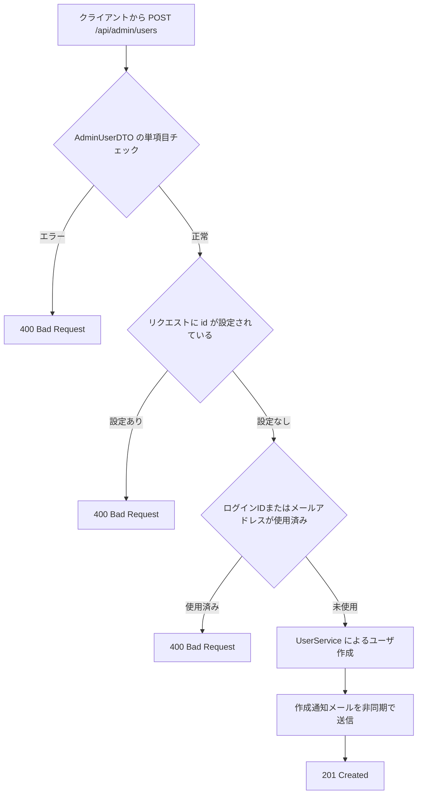

# 【JHipsterサンプルアプリ】サービス詳細設計書_ユーザ管理

## 改版履歴

| **版数（Ver）** | **版数（Rev）** | **改版日付** | **改版シート** | **改版内容** | **担当者** | **確認者** |
| --- | --- | --- | --- | --- | --- | --- |
| 1.0 |  | 2026/11/23 |  | 初版作成 |  |  |

---

## 目次

| サブシステム名(ID) | 機能ID | 機能日本語名 | 処理名 | 処理種別 |
| --- | --- | --- | --- | --- |
| JHipsterサンプルアプリ | UserResource | ユーザ管理 |  | 検索・登録・更新・削除 |

目次

| 項番 | シート名 |
| --- | --- |
| 1 | 処理概要、処理フロー図 |
| 2 | 1　対象クラス |
| 3 | 2　API定義 |
| 4 | 3　単項目チェック |
| 5 | 4　相関項目チェック |
| 6 | 5　依存クラス |
| 7 | 6　処理詳細（POST /api/admin/users） |
| 8 | 7　処理詳細（PUT /api/admin/users） |
| 9 | 8　処理詳細（GET /api/admin/users） |
| 10 | 9　処理詳細（GET /api/admin/users/{login}） |
| 11 | 10　処理詳細（DELETE /api/admin/users/{login}） |
| 12 | 11　エラー一覧 |

---

## 処理概要、処理フロー図

| サブシステム名(ID) | 機能ID | 機能日本語名 | 処理名 | 処理種別 |
| --- | --- | --- | --- | --- |
| JHipsterサンプルアプリ | UserResource | ユーザ管理 |  | 検索・登録・更新・削除 |

### 処理概要

| ・ | 管理者がユーザを検索、登録、更新、削除する。 |
| --- | --- |

コール元に対する補足説明

フロントエンド（別リポジトリ）が HTTP で呼び出す。全エンドポイントに管理者権限 `ROLE_ADMIN` が必要である。登録したユーザには作成通知のメールを送信する。

処理フロー図「ユーザ作成（POST /api/admin/users）」

---

## 1　対象クラス

| サブシステム名(ID) | 機能ID | 機能日本語名 | 処理名 | 処理種別 |
| --- | --- | --- | --- | --- |
| JHipsterサンプルアプリ | UserResource | ユーザ管理 | 対象クラス | 検索・登録・更新・削除 |

### 処理詳細

| No | クラス | ファイルパス（リポジトリルート基準） | 役割 |
| --- | --- | --- | --- |
| 1 | `UserResource` | `src/main/java/io/github/jhipster/sample/web/rest/UserResource.java` | ユーザ管理のエンドポイント |
| 2 | `AdminUserDTO` | `src/main/java/io/github/jhipster/sample/service/dto/AdminUserDTO.java` | リクエスト・応答の DTO |
| 3 | `UserService` | `src/main/java/io/github/jhipster/sample/service/UserService.java` | ユーザの登録、更新、検索、削除 |
| 4 | `MailService` | `src/main/java/io/github/jhipster/sample/service/MailService.java` | 作成通知メールの送信 |
| 5 | `UserRepository` | `src/main/java/io/github/jhipster/sample/repository/UserRepository.java` | ユーザテーブルへのアクセス |
| 6 | `BadRequestAlertException` | `src/main/java/io/github/jhipster/sample/web/rest/errors/BadRequestAlertException.java` | ID 指定のエラー |
| 7 | `LoginAlreadyUsedException` | `src/main/java/io/github/jhipster/sample/web/rest/errors/LoginAlreadyUsedException.java` | ログインIDの重複エラー |
| 8 | `EmailAlreadyUsedException` | `src/main/java/io/github/jhipster/sample/web/rest/errors/EmailAlreadyUsedException.java` | メールアドレスの重複エラー |

---

## 2　API定義

| サブシステム名(ID) | 機能ID | 機能日本語名 | 処理名 | 処理種別 |
| --- | --- | --- | --- | --- |
| JHipsterサンプルアプリ | UserResource | ユーザ管理 | API定義 | 検索・登録・更新・削除 |

### 処理詳細

| No | HTTPメソッド | URL | リソースクラス | メソッド | 認可 | リクエスト | 応答本文 | 正常時ステータス | トランザクション |
| --- | --- | --- | --- | --- | --- | --- | --- | --- | --- |
| 1 | POST | `/api/admin/users` | UserResource | `createUser` | ROLE_ADMIN | 本文 `AdminUserDTO`（JSON） | `User` | 201 | サービス層がトランザクションを管理する（読み書き） |
| 2 | PUT | `/api/admin/users`、`/api/admin/users/{login}` | UserResource | `updateUser` | ROLE_ADMIN | パス変数 `login`（任意）、本文 `AdminUserDTO`（JSON） | `AdminUserDTO` | 200 | サービス層がトランザクションを管理する（読み書き） |
| 3 | GET | `/api/admin/users` | UserResource | `getAllUsers` | ROLE_ADMIN | ページング（`page`、`size`、`sort`） | `AdminUserDTO` の配列 | 200 | サービス層がトランザクションを管理する（読み取り専用） |
| 4 | GET | `/api/admin/users/{login}` | UserResource | `getUser` | ROLE_ADMIN | パス変数 `login` | `AdminUserDTO` | 200 | サービス層がトランザクションを管理する（読み取り専用） |
| 5 | DELETE | `/api/admin/users/{login}` | UserResource | `deleteUser` | ROLE_ADMIN | パス変数 `login` | なし | 204 | サービス層がトランザクションを管理する（読み書き） |

いずれのエンドポイントも、リソースクラス自身はトランザクションを開始しない。更新系は `UserService`（クラスレベルの `@Transactional`）がトランザクションを管理する。

---

## 3　単項目チェック

| サブシステム名(ID) | 機能ID | 機能日本語名 | 処理名 | 処理種別 |
| --- | --- | --- | --- | --- |
| JHipsterサンプルアプリ | UserResource | ユーザ管理 | 単項目チェック | 検索・登録・更新・削除 |

### 処理概要

リクエストデータ部の単項目チェックを実施する。

### 処理詳細

#### １）リクエスト本文のチェック

`POST /api/admin/users` と `PUT /api/admin/users` が対象である。チェックは `AdminUserDTO` の Bean Validation アノテーションで行う。項目とアノテーションは「SERVICE_DTO設計書_ユーザ管理」を参照。

チェックエラーの場合、業務エラーと返す。

#### ２）ページングのチェック

`GET /api/admin/users` において、`sort` で指定されたプロパティが次の許可リストに含まれない場合、400（応答本文なし）を返す。許可リストは `UserResource.ALLOWED_ORDERED_PROPERTIES` である。

| No | 許可するソートプロパティ |
| --- | --- |
| 1 | `id` |
| 2 | `login` |
| 3 | `firstName` |
| 4 | `lastName` |
| 5 | `email` |
| 6 | `activated` |
| 7 | `langKey` |
| 8 | `createdBy` |
| 9 | `createdDate` |
| 10 | `lastModifiedBy` |
| 11 | `lastModifiedDate` |

#### ３）パス変数のチェック

`PUT`、`GET /{login}`、`DELETE /{login}` のパス変数 `login` には `@Pattern(regexp = Constants.LOGIN_REGEX)` を付与している。ただし `UserResource` にはクラスレベルの `@Validated` がないため、このチェックがフレームワークのメソッドバリデーションで実際に実行されるかどうかは、本リポジトリのコードからは確定できない（未確認）。

---

## 4　相関項目チェック

| サブシステム名(ID) | 機能ID | 機能日本語名 | 処理名 | 処理種別 |
| --- | --- | --- | --- | --- |
| JHipsterサンプルアプリ | UserResource | ユーザ管理 | 相関項目チェック | 検索・登録・更新・削除 |

### 処理概要

ID の指定と、ログインID・メールアドレスの一意性をチェックする。

### 処理詳細

チェックはリソースクラス内のコードで行う。

#### １）登録時（POST /api/admin/users）

| No | チェック | 発生条件 | 例外 | エラーキー |
| --- | --- | --- | --- | --- |
| 1 | ID の指定 | リクエスト本文．`id` が null 以外 | `BadRequestAlertException("A new user cannot already have an ID", "userManagement", "idexists")` | `idexists` |
| 2 | ログインIDの重複 | `UserRepository#findOneByLogin(リクエスト本文．login を小文字化した値)` の結果があり | `LoginAlreadyUsedException` | `userexists` |
| 3 | メールアドレスの重複 | `UserRepository#findOneByEmailIgnoreCase(リクエスト本文．email)` の結果があり | `EmailAlreadyUsedException` | `emailexists` |

#### ２）更新時（PUT /api/admin/users）

| No | チェック | 発生条件 | 例外 | エラーキー |
| --- | --- | --- | --- | --- |
| 1 | メールアドレスの重複 | `findOneByEmailIgnoreCase` の結果があり、かつその `id` がリクエスト本文．`id` と異なる | `EmailAlreadyUsedException` | `emailexists` |
| 2 | ログインIDの重複 | `findOneByLogin` の結果があり、かつその `id` がリクエスト本文．`id` と異なる | `LoginAlreadyUsedException` | `userexists` |

いずれの場合も業務エラー（400）を返す。

---

## 5　依存クラス

| サブシステム名(ID) | 機能ID | 機能日本語名 | 処理名 | 処理種別 |
| --- | --- | --- | --- | --- |
| JHipsterサンプルアプリ | UserResource | ユーザ管理 | 依存クラス | 検索・登録・更新・削除 |

### 処理概要

コンストラクタインジェクションで、本クラスが使う次の Bean を注入する。

### 処理詳細

| No | クラス | フィールド | 用途 |
| --- | --- | --- | --- |
| 1 | `UserService` | `userService` | ユーザの登録、更新、検索、削除 |
| 2 | `UserRepository` | `userRepository` | 重複チェック |
| 3 | `MailService` | `mailService` | 作成通知メールの送信 |

`@Value("${jhipster.clientApp.name:jhipsterSampleApplication}")` で読み込む `applicationName` は、アラートヘッダの名前に使う。

`UserRepository` の `save`、`delete`、`findById`、`findAll` は、`JpaRepository` から継承したメソッドである。リポジトリのインターフェースには宣言がない。

---

## 6　処理詳細（POST /api/admin/users）

| サブシステム名(ID) | 機能ID | 機能日本語名 | 処理名 | 処理種別 |
| --- | --- | --- | --- | --- |
| JHipsterサンプルアプリ | UserResource | ユーザ管理 | createUser | 登録 |

### 処理概要

ユーザを有効化済みの状態で作成し、作成通知メールを送信する。

### 処理詳細

対象メソッドは `UserResource#createUser(@Valid @RequestBody AdminUserDTO userDTO)` である。

#### １）相関項目チェックを行う。

「4　相関項目チェック」のとおり。

#### ２）ユーザを作成する。

| クラス | `UserService` |  |
| --- | --- | --- |
| メソッド | `createUser` |  |
| 引数 | 引数名 | 値 |
|  | parameter1 | リクエスト本文（`AdminUserDTO`） |
| 戻り値 | `User` | 作成したユーザ |

`UserService#createUser(AdminUserDTO userDTO)` の処理は次のとおりである。

| No | 編集項目 | 編集仕様 | 備考 |
| --- | --- | --- | --- |
| 1 | `login` | リクエスト本文．`login` を `toLowerCase` で小文字化した値 |  |
| 2 | `firstName` | リクエスト本文．`firstName` |  |
| 3 | `lastName` | リクエスト本文．`lastName` |  |
| 4 | `email` | リクエスト本文．`email` を小文字化した値 | `email` が null の場合は設定しない |
| 5 | `imageUrl` | リクエスト本文．`imageUrl` |  |
| 6 | `langKey` | リクエスト本文．`langKey` | null の場合は `Constants.DEFAULT_LANGUAGE`（`en`） |
| 7 | `password` | `passwordEncoder.encode(RandomUtil.generatePassword())` | 20 桁のランダムな英数字をハッシュ化したもの |
| 8 | `resetKey` | `RandomUtil.generateResetKey()` | 20 桁の英数字 |
| 9 | `resetDate` | `Instant.now()` |  |
| 10 | `activated` | `true` | 有効化済みで作成する |
| 11 | `authorities` | リクエスト本文．`authorities` の各権限名を `AuthorityRepository#findById` で検索し、存在するものだけを設定 | リクエスト本文．`authorities` が null の場合は権限を設定しない（空になる） |

`UserRepository#save` で保存し、`clearUserCaches` でユーザのキャッシュを削除する。

#### ３）作成通知メールを送信する。

| クラス | `MailService` |  |
| --- | --- | --- |
| メソッド | `sendCreationEmail` |  |
| 引数 | 引数名 | 値 |
|  | parameter1 | 手順２）で作成した `User` |
| 戻り値 | なし |  |

非同期で送信する。テンプレートは `mail/creationEmail` である。詳細は「01_共通仕様書 メール送信設計書」を参照。

#### ４）応答を返す。

| 項目 | 内容 |
| --- | --- |
| ステータス | 201 |
| ヘッダ | `Location: /api/admin/users/{login}`、`X-jhipsterSampleApplicationApp-alert: userManagement.created`、`X-jhipsterSampleApplicationApp-params: {login}` |
| 応答本文 | 作成した `User` の JSON |

`User` の JSON には、`@JsonIgnore` を付与した `password`、`activationKey`、`resetKey`、`authorities` は含まれない。ヘッダ名の `jhipsterSampleApplicationApp` は設定値 `jhipster.clientApp.name` である。

---

## 7　処理詳細（PUT /api/admin/users）

| サブシステム名(ID) | 機能ID | 機能日本語名 | 処理名 | 処理種別 |
| --- | --- | --- | --- | --- |
| JHipsterサンプルアプリ | UserResource | ユーザ管理 | updateUser | 更新 |

### 処理概要

既存のユーザの情報を更新する。

### 処理詳細

対象メソッドは `UserResource#updateUser(@PathVariable(name = "login", required = false) @Pattern(regexp = Constants.LOGIN_REGEX) String login, @Valid @RequestBody AdminUserDTO userDTO)` である。

パス変数の `login` は更新処理には使わない。更新対象はリクエスト本文．`id` で特定する。

#### １）相関項目チェックを行う。

「4　相関項目チェック」のとおり。

#### ２）ユーザを更新する。

| クラス | `UserService` |  |
| --- | --- | --- |
| メソッド | `updateUser` |  |
| 引数 | 引数名 | 値 |
|  | parameter1 | リクエスト本文（`AdminUserDTO`） |
| 戻り値 | `Optional<AdminUserDTO>` | 更新したユーザ。該当なしの場合は空 |

`UserService#updateUser(AdminUserDTO userDTO)` の処理は次のとおりである。

| No | 条件 | 処理 |
| --- | --- | --- |
| 1 | `UserRepository#findById(リクエスト本文．id)` の結果がない | 空の `Optional` を返す（呼び出し元が 404 を返す） |
| 2 | 結果がある | 下表の項目を編集する |

| No | 編集項目 | 編集仕様 | 備考 |
| --- | --- | --- | --- |
| 1 | `login` | リクエスト本文．`login` を小文字化した値 | ログインIDの変更も可能 |
| 2 | `firstName` | リクエスト本文．`firstName` |  |
| 3 | `lastName` | リクエスト本文．`lastName` |  |
| 4 | `email` | リクエスト本文．`email` を小文字化した値 | `email` が null の場合は更新しない |
| 5 | `imageUrl` | リクエスト本文．`imageUrl` |  |
| 6 | `activated` | リクエスト本文．`activated` |  |
| 7 | `langKey` | リクエスト本文．`langKey` |  |
| 8 | `authorities` | 既存の権限の集合を空にし、リクエスト本文．`authorities` のうち `AuthorityRepository#findById` で存在するものを追加 | パスワード、リセットキー、有効化キーは更新しない |

更新の前後に `clearUserCaches` でユーザのキャッシュを削除し、`UserRepository#save` で保存して `AdminUserDTO` に変換する。

#### ３）応答を返す。

| 条件 | ステータス | ヘッダ | 応答本文 |
| --- | --- | --- | --- |
| 更新できた | 200 | `X-jhipsterSampleApplicationApp-alert: userManagement.updated`、`X-jhipsterSampleApplicationApp-params: {リクエスト本文．login}` | 更新後の `AdminUserDTO` |
| `id` に該当するユーザがない | 404 | なし | Problem Details |

---

## 8　処理詳細（GET /api/admin/users）

| サブシステム名(ID) | 機能ID | 機能日本語名 | 処理名 | 処理種別 |
| --- | --- | --- | --- | --- |
| JHipsterサンプルアプリ | UserResource | ユーザ管理 | getAllUsers | 検索 |

### 処理概要

全ユーザをページング付きで検索する。

### 処理詳細

対象メソッドは `UserResource#getAllUsers(@ParameterObject Pageable pageable)` である。

#### １）ソートプロパティをチェックする。

`onlyContainsAllowedProperties(pageable)` が false の場合、400（応答本文なし）とする。

#### ２）ユーザを検索する。

| クラス | `UserService` |  |
| --- | --- | --- |
| メソッド | `getAllManagedUsers` |  |
| 引数 | 引数名 | 値 |
|  | parameter1 | `pageable` |
| 戻り値 | `Page<AdminUserDTO>` |  |

`UserRepository#findAll(pageable)` の結果を `AdminUserDTO` に変換する。抽出条件はない（未有効化ユーザを含む全件）。

#### ３）応答を返す。

| 項目 | 内容 |
| --- | --- |
| ステータス | 200 |
| ヘッダ | `X-Total-Count: {総件数}`、`Link: {先頭、前、次、最終ページへのリンク}` |
| 応答本文 | `AdminUserDTO` の配列（ページ内の分のみ） |

ヘッダは `PaginationUtil#generatePaginationHttpHeaders` が生成する。

---

## 9　処理詳細（GET /api/admin/users/{login}）

| サブシステム名(ID) | 機能ID | 機能日本語名 | 処理名 | 処理種別 |
| --- | --- | --- | --- | --- |
| JHipsterサンプルアプリ | UserResource | ユーザ管理 | getUser | 検索 |

### 処理概要

ログインIDを指定してユーザを検索する。

### 処理詳細

対象メソッドは `UserResource#getUser(@PathVariable("login") @Pattern(regexp = Constants.LOGIN_REGEX) String login)` である。

#### １）ユーザを検索する。

| クラス | `UserService` |  |
| --- | --- | --- |
| メソッド | `getUserWithAuthoritiesByLogin` |  |
| 引数 | 引数名 | 値 |
|  | parameter1 | パス変数．`login` |
| 戻り値 | `Optional<User>` |  |

`UserRepository#findOneWithAuthoritiesByLogin(login)` で権限も同時に読み込んで検索する。ログインIDの小文字化は行わない。

#### ２）応答を返す。

| 条件 | ステータス | 応答本文 |
| --- | --- | --- |
| 該当あり | 200 | `AdminUserDTO` |
| 該当なし | 404 | Problem Details |

---

## 10　処理詳細（DELETE /api/admin/users/{login}）

| サブシステム名(ID) | 機能ID | 機能日本語名 | 処理名 | 処理種別 |
| --- | --- | --- | --- | --- |
| JHipsterサンプルアプリ | UserResource | ユーザ管理 | deleteUser | 削除 |

### 処理概要

ログインIDを指定してユーザを削除する。

### 処理詳細

対象メソッドは `UserResource#deleteUser(@PathVariable("login") @Pattern(regexp = Constants.LOGIN_REGEX) String login)` である。

#### １）ユーザを削除する。

| クラス | `UserService` |  |
| --- | --- | --- |
| メソッド | `deleteUser` |  |
| 引数 | 引数名 | 値 |
|  | parameter1 | パス変数．`login` |
| 戻り値 | なし |  |

`UserRepository#findOneByLogin(login)` の結果がある場合、`UserRepository#delete` で削除し、`clearUserCaches` でキャッシュを削除する。結果がない場合は何もしない。ログイン中のユーザ自身を削除しようとしているかどうかのチェックはない。

#### ２）応答を返す。

ステータス 204、応答本文なし。ヘッダ `X-jhipsterSampleApplicationApp-alert: userManagement.deleted`、`X-jhipsterSampleApplicationApp-params: {login}` を返す。該当するユーザがない場合も同じ 204 を返す。

---

## 11　エラー一覧

| サブシステム名(ID) | 機能ID | 機能日本語名 | 処理名 | 処理種別 |
| --- | --- | --- | --- | --- |
| JHipsterサンプルアプリ | UserResource | ユーザ管理 | エラー一覧 | 検索・登録・更新・削除 |

### 処理詳細

エラー応答の本文は RFC 7807（Problem Details）形式である。変換規則は「01_共通仕様書 例外処理設計書」を参照。

| No | HTTPメソッド | 発生条件 | ステータス | `type` | `message` | 根拠 |
| --- | --- | --- | --- | --- | --- | --- |
| 1 | POST、PUT | `AdminUserDTO` の単項目チェックエラー | 400 | `constraint-violation` | `error.validation` | コード（`@Valid`） |
| 2 | POST | リクエスト本文に `id` が設定されている | 400 | `problem-with-message` | `error.idexists` | `UserResourceIT#createUserWithExistingId` |
| 3 | POST、PUT | ログインIDが他ユーザと重複 | 400 | `login-already-used` | `error.userexists` | `UserResourceIT#createUserWithExistingLogin`、`updateUserExistingLogin` |
| 4 | POST、PUT | メールアドレスが他ユーザと重複 | 400 | `email-already-used` | `error.emailexists` | `UserResourceIT#createUserWithExistingEmail`、`updateUserExistingEmail` |
| 5 | GET（一覧） | 許可されていないソートプロパティ | 400 | － | 本文なし | コード（`onlyContainsAllowedProperties`） |
| 6 | GET（一件）、PUT | 指定したユーザが存在しない | 404 | `problem-with-message` | `error.http.404` | `UserResourceIT#getNonExistingUser` |
| 7 | 全エンドポイント | 未認証、または JWT が無効 | 401 | － | 本文なし | コード（`SecurityConfiguration`） |
| 8 | 全エンドポイント | `ROLE_ADMIN` 以外のユーザ | 403 | － | 本文なし | コード（`/api/admin/**` の `hasAuthority`） |

---
