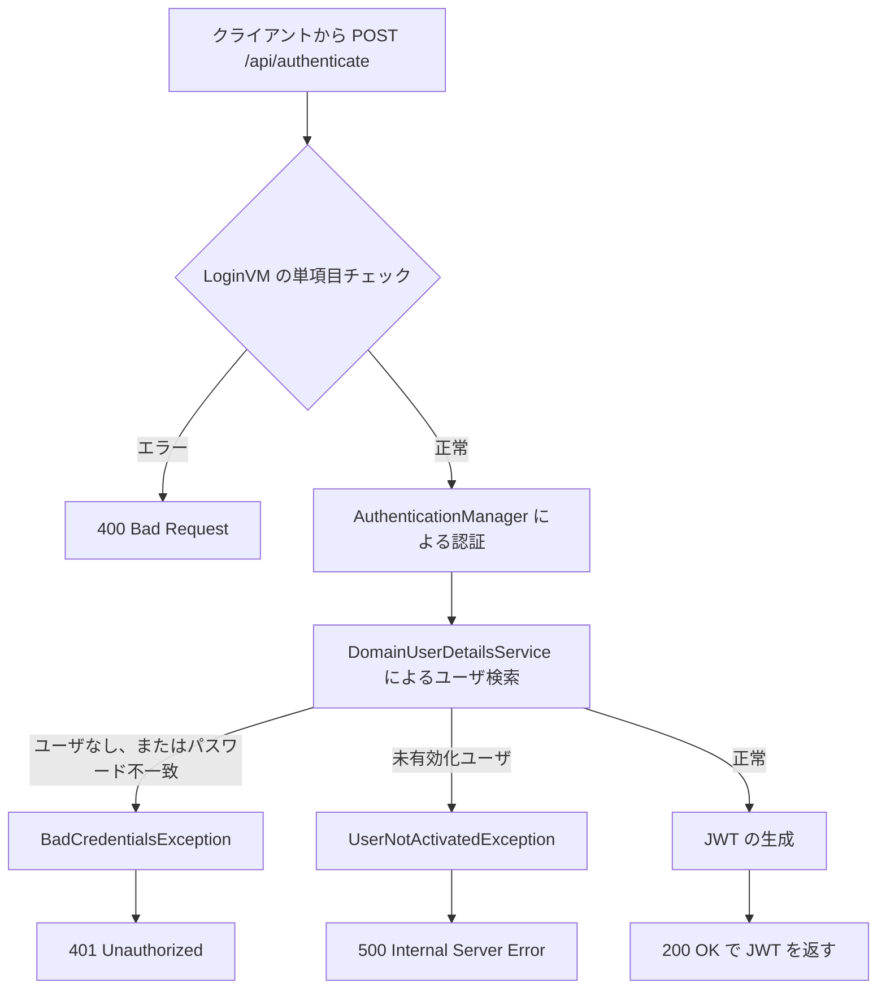

# 【JHipsterサンプルアプリ】サービス詳細設計書_ログイン認証

## 改版履歴

| **版数（Ver）** | **版数（Rev）** | **改版日付** | **改版シート** | **改版内容** | **担当者** | **確認者** |
| --- | --- | --- | --- | --- | --- | --- |
| 1.0 |  | 2026/11/23 |  | 初版作成 |  |  |

---

## 目次

| サブシステム名(ID) | 機能ID | 機能日本語名 | 処理名 | 処理種別 |
| --- | --- | --- | --- | --- |
| JHipsterサンプルアプリ | AuthenticateController | ログイン認証 |  | 認証 |

目次

| 項番 | シート名 |
| --- | --- |
| 1 | 処理概要、処理フロー図 |
| 2 | 1　対象クラス |
| 3 | 2　API定義 |
| 4 | 3　単項目チェック |
| 5 | 4　依存クラス |
| 6 | 5　処理詳細（POST /api/authenticate） |
| 7 | 6　処理詳細（GET /api/authenticate） |
| 8 | 7　JWTの構成 |
| 9 | 8　エラー一覧 |

---

## 処理概要、処理フロー図

| サブシステム名(ID) | 機能ID | 機能日本語名 | 処理名 | 処理種別 |
| --- | --- | --- | --- | --- |
| JHipsterサンプルアプリ | AuthenticateController | ログイン認証 |  | 認証 |

### 処理概要

| ・ | ログインID（ユーザ名またはメールアドレス）とパスワードでユーザを認証し、JWT を発行する。 |
| --- | --- |
| ・ | リクエストに付与された JWT が有効かどうかを、ステータスコードで返す。 |

コール元に対する補足説明

フロントエンド（別リポジトリ `jhipster-sample-app-frontend`）が HTTP で呼び出す。両エンドポイントとも未認証で呼び出せる。フロントエンドは発行された JWT を、以降のリクエストの `Authorization: Bearer <JWT>` ヘッダに設定する。

処理フロー図「ログイン認証（POST /api/authenticate）」

---

## 1　対象クラス

| サブシステム名(ID) | 機能ID | 機能日本語名 | 処理名 | 処理種別 |
| --- | --- | --- | --- | --- |
| JHipsterサンプルアプリ | AuthenticateController | ログイン認証 | 対象クラス | 認証 |

### 処理詳細

| No | クラス | ファイルパス（リポジトリルート基準） | 役割 |
| --- | --- | --- | --- |
| 1 | `AuthenticateController` | `src/main/java/io/github/jhipster/sample/web/rest/AuthenticateController.java` | ログイン認証のエンドポイント。JWT の生成も行う |
| 2 | `LoginVM` | `src/main/java/io/github/jhipster/sample/web/rest/vm/LoginVM.java` | ログインのリクエスト本文（VM） |
| 3 | `DomainUserDetailsService` | `src/main/java/io/github/jhipster/sample/security/DomainUserDetailsService.java` | データベースのユーザ情報による認証 |
| 4 | `UserNotActivatedException` | `src/main/java/io/github/jhipster/sample/security/UserNotActivatedException.java` | 未有効化ユーザの認証時に発生する例外 |
| 5 | `SecurityUtils` | `src/main/java/io/github/jhipster/sample/security/SecurityUtils.java` | JWT の署名アルゴリズムとクレーム名の定義 |
| 6 | `SecurityJwtConfiguration` | `src/main/java/io/github/jhipster/sample/config/SecurityJwtConfiguration.java` | `JwtEncoder`、`JwtDecoder` の Bean 定義 |
| 7 | `SecurityConfiguration` | `src/main/java/io/github/jhipster/sample/config/SecurityConfiguration.java` | パスごとの認可と `PasswordEncoder` の定義 |

---

## 2　API定義

| サブシステム名(ID) | 機能ID | 機能日本語名 | 処理名 | 処理種別 |
| --- | --- | --- | --- | --- |
| JHipsterサンプルアプリ | AuthenticateController | ログイン認証 | API定義 | 認証 |

### 処理詳細

| No | HTTPメソッド | URL | リソースクラス | メソッド | 認可 | リクエスト | 応答本文 | 正常時ステータス | トランザクション |
| --- | --- | --- | --- | --- | --- | --- | --- | --- | --- |
| 1 | POST | `/api/authenticate` | AuthenticateController | `authorize` | 不要 | `LoginVM`（JSON） | `JWTToken` | 200 | なし |
| 2 | GET | `/api/authenticate` | AuthenticateController | `isAuthenticated` | 不要 | なし | なし | 204（未認証の場合は 401） | なし |

---

## 3　単項目チェック

| サブシステム名(ID) | 機能ID | 機能日本語名 | 処理名 | 処理種別 |
| --- | --- | --- | --- | --- |
| JHipsterサンプルアプリ | AuthenticateController | ログイン認証 | 単項目チェック | 認証 |

### 処理概要

リクエストデータ部の単項目チェックを実施する。チェックは `LoginVM` の Bean Validation アノテーションで行う。

### 処理詳細

`POST /api/authenticate` のみが対象である。`GET /api/authenticate` はリクエスト本文を持たないため、単項目チェックはない。

| No | 項目 | 型 | 必須 | 桁数 | アノテーション | 備考 |
| --- | --- | --- | --- | --- | --- | --- |
| 1 | `username` | String | ○ | 1～254 | `@NotNull`、`@Size(min = 1, max = 254)` | ユーザ名またはメールアドレス |
| 2 | `password` | String | ○ | 4～100 | `@NotNull`、`@Size(min = 4, max = 100)` | 平文のパスワード |
| 3 | `rememberMe` | boolean | － | － | なし | 省略時は `false` |

チェックエラーの場合、業務エラーと返す。エラー応答の形式は「01_共通仕様書 例外処理設計書」を参照。

---

## 4　依存クラス

| サブシステム名(ID) | 機能ID | 機能日本語名 | 処理名 | 処理種別 |
| --- | --- | --- | --- | --- |
| JHipsterサンプルアプリ | AuthenticateController | ログイン認証 | 依存クラス | 認証 |

### 処理概要

コンストラクタインジェクションで、本クラスが使う次の Bean を注入する。

### 処理詳細

| No | クラス | フィールド | 用途 |
| --- | --- | --- | --- |
| 1 | `JwtEncoder` | `jwtEncoder` | JWT の署名と生成。`SecurityJwtConfiguration#jwtEncoder` で定義する |
| 2 | `AuthenticationManagerBuilder` | `authenticationManagerBuilder` | 認証マネージャの取得 |

`@Value` で読み込む設定値は次のとおりである。

| No | 設定キー | フィールド | 用途 |
| --- | --- | --- | --- |
| 1 | `jhipster.security.authentication.jwt.token-validity-in-seconds` | `tokenValidityInSeconds` | JWT の有効期限（秒） |
| 2 | `jhipster.security.authentication.jwt.token-validity-in-seconds-for-remember-me` | `tokenValidityInSecondsForRememberMe` | `rememberMe` が true の場合の JWT の有効期限（秒） |

---

## 5　処理詳細（POST /api/authenticate）

| サブシステム名(ID) | 機能ID | 機能日本語名 | 処理名 | 処理種別 |
| --- | --- | --- | --- | --- |
| JHipsterサンプルアプリ | AuthenticateController | ログイン認証 | authorize | 認証 |

### 処理概要

ログインIDとパスワードを検証し、JWT を発行する。

### 処理詳細

対象メソッドは `AuthenticateController#authorize(@Valid @RequestBody LoginVM loginVM)` である。

#### １）認証トークンを生成する。

`UsernamePasswordAuthenticationToken(loginVM.getUsername(), loginVM.getPassword())` を生成する。

#### ２）認証を実行する。

| クラス | `AuthenticationManagerBuilder` |  |
| --- | --- | --- |
| メソッド | `getObject().authenticate` |  |
| 引数 | 引数名 | 値 |
|  | parameter1 | 手順１）の認証トークン |
| 戻り値 | `Authentication` |  |

認証マネージャは Spring Security が組み立てる。ユーザ情報の取得は `DomainUserDetailsService#loadUserByUsername`、パスワードの照合は `SecurityConfiguration#passwordEncoder` で定義した `BCryptPasswordEncoder` が行う。

`DomainUserDetailsService#loadUserByUsername(login)` の処理は次のとおりである。

| No | 条件 | 処理 | 結果 |
| --- | --- | --- | --- |
| 1 | `login` がメールアドレス形式（`EmailValidator#isValid` が true） | `UserRepository#findOneWithAuthoritiesByEmailIgnoreCase(login)` で検索する | － |
| 2 | 上記以外 | `login` を `toLowerCase(Locale.ENGLISH)` で小文字化し、`UserRepository#findOneWithAuthoritiesByLogin` で検索する | － |
| 3 | 検索結果が 0 件 | `UsernameNotFoundException` をスローする。Spring Security はこれを `BadCredentialsException` として呼び出し元に伝える | 401 |
| 4 | 検索結果あり、`activated` が false | `UserNotActivatedException` をスローする。Spring Security はこれを `InternalAuthenticationServiceException` として呼び出し元に伝え、`ExceptionTranslator` はそれを 500 に変換する | 500 |
| 5 | 検索結果あり、`activated` が true | `UserWithId.fromUser(user)` を返す | 認証プリンシパルとなる |

ユーザが存在しない場合とパスワードが一致しない場合は、どちらも 401 で `type`、`title`、`message`（`error.http.401`）も同じである。ただし `detail` は異なる。ユーザが存在しない場合は `User <ログインID> was not found in the database` となり、パスワードが一致しない場合は `Bad credentials` となる。すなわち、ログイン ID が登録済みかどうかを、応答の `detail` から判別できる。ユーザが存在しない場合は `AuthenticateControllerIT#testAuthorizeFails` が確認しており、パスワードが一致しない場合と `detail` の違いは動作確認した（2026/11/24、開発用の設定）。

`UserWithId` は Spring Security の `User` のサブクラスであり（`DomainUserDetailsService` の static ネストクラス）、次の値を持つ。

| 項目 | 設定値 |
| --- | --- |
| ユーザ名 | `User#getLogin()` |
| パスワード | `User#getPassword()`（ハッシュ値） |
| 権限 | `User#getAuthorities()` の各 `Authority#getName()` を `SimpleGrantedAuthority` にしたもの |
| id | `User#getId()` |

#### ３）認証情報をコンテキストに設定する。

`SecurityContextHolder.getContext().setAuthentication(authentication)` を実行する。

#### ４）JWT を生成する。

| クラス | `AuthenticateController` |  |
| --- | --- | --- |
| メソッド | `createToken` |  |
| 引数 | 引数名 | 値 |
|  | parameter1 | 手順２）の `Authentication` |
|  | parameter2 | `loginVM.isRememberMe()` |
| 戻り値 | `String`（JWT） |  |

クレームの内容は「7　JWTの構成」を参照。

#### ５）応答を返す。

| 項目 | 内容 |
| --- | --- |
| ステータス | 200 |
| ヘッダ | `Authorization: Bearer <JWT>`（`HttpHeaders#setBearerAuth`） |
| 応答本文 | `{"id_token": "<JWT>"}` |

---

## 6　処理詳細（GET /api/authenticate）

| サブシステム名(ID) | 機能ID | 機能日本語名 | 処理名 | 処理種別 |
| --- | --- | --- | --- | --- |
| JHipsterサンプルアプリ | AuthenticateController | ログイン認証 | isAuthenticated | 認証 |

### 処理概要

リクエストが認証済みかどうかを返す。

### 処理詳細

対象メソッドは `AuthenticateController#isAuthenticated(Principal principal)` である。

| No | 条件 | ステータス | 応答本文 |
| --- | --- | --- | --- |
| 1 | `principal` が null 以外（JWT が有効、または認証済み） | 204 | なし |
| 2 | `principal` が null（未認証） | 401 | なし |

本エンドポイントは未認証で呼び出せるため、JWT が無効（署名不正、期限切れ、形式不正）な場合もリソースクラスに到達し、No 2 の 401 を返す（`TokenAuthenticationIT` が確認している）。

---

## 7　JWTの構成

| サブシステム名(ID) | 機能ID | 機能日本語名 | 処理名 | 処理種別 |
| --- | --- | --- | --- | --- |
| JHipsterサンプルアプリ | AuthenticateController | ログイン認証 | JWTの構成 | 認証 |

### 処理詳細

署名アルゴリズムは `SecurityUtils.JWT_ALGORITHM`（`HS512`）である。秘密鍵は設定値 `jhipster.security.authentication.jwt.base64-secret` を Base64 デコードしたものである。

| No | クレーム | 設定値 | 出力条件 |
| --- | --- | --- | --- |
| 1 | `sub` | `authentication.getName()`（ログインID） | 常に設定する |
| 2 | `auth` | 権限名を半角空白で連結した文字列 | 常に設定する |
| 3 | `userId` | `UserWithId#getId()` | 認証プリンシパルが `UserWithId` の場合のみ設定する |
| 4 | `iat` | 発行日時（`Instant.now()`） | 常に設定する |
| 5 | `exp` | 発行日時 + 有効期限（秒） | 常に設定する |

有効期限（秒）は、`rememberMe` が true の場合は `token-validity-in-seconds-for-remember-me`、false の場合は `token-validity-in-seconds` を使う。設定値は「01_共通仕様書 アプリケーション設定情報」を参照。

`auth` クレームは、以降のリクエストの認可にも使う。設定 `spring.security.oauth2.resourceserver.jwt.authorities-claim-name` が `auth`、`authority-prefix` が空文字であるため、`auth` の値はそのまま権限名（例 `ROLE_ADMIN`、`ROLE_USER`）として扱う。

---

## 8　エラー一覧

| サブシステム名(ID) | 機能ID | 機能日本語名 | 処理名 | 処理種別 |
| --- | --- | --- | --- | --- |
| JHipsterサンプルアプリ | AuthenticateController | ログイン認証 | エラー一覧 | 認証 |

### 処理詳細

エラー応答の本文は RFC 7807（Problem Details）形式である。変換規則は「01_共通仕様書 例外処理設計書」を参照。

| No | HTTPメソッド | 発生条件 | ステータス | `type` | `message` | 根拠 |
| --- | --- | --- | --- | --- | --- | --- |
| 1 | POST | `LoginVM` の単項目チェックエラー | 400 | `constraint-violation` | `error.validation`（`fieldErrors` 付き） | コード（`@Valid`） |
| 2 | POST | ユーザが存在しない（`detail` は `User <ログインID> was not found in the database`）、またはパスワード不一致（`detail` は `Bad credentials`） | 401 | `problem-with-message` | `error.http.401` | ユーザが存在しない場合は `AuthenticateControllerIT#testAuthorizeFails`。パスワード不一致の場合と `detail` の内容は動作確認（2026/11/24） |
| 3 | POST | 未有効化のユーザ | 500 | `problem-with-message` | `error.http.500` | 動作確認（2026/11/24）。`ExceptionTranslator` は、`UserNotActivatedException` を包んだ `InternalAuthenticationServiceException` を受け取り、ステータスを対応付ける規則がないため 500 とする |
| 4 | GET | 未認証、または JWT が無効 | 401 | － | 本文なし | `AccountResourceIT#testNonAuthenticatedUser`、`TokenAuthenticationIT` |

---
