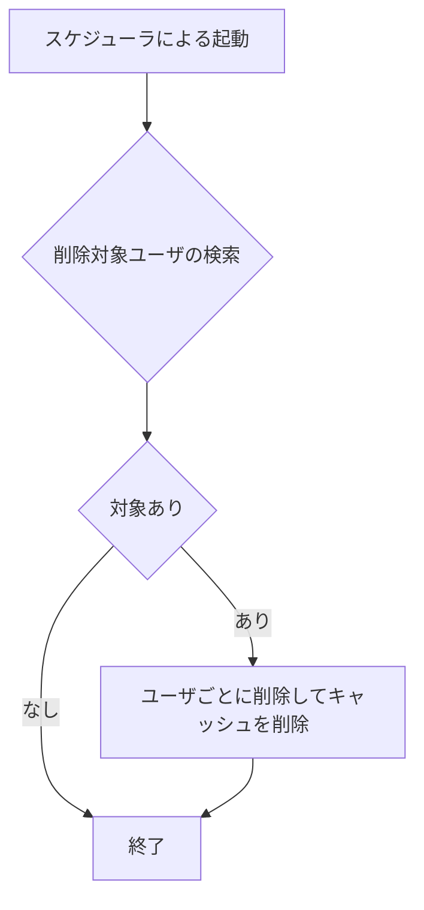

# 【JHipsterサンプルアプリ】サービス詳細設計書_未有効化ユーザ一括削除

## 改版履歴

| **版数（Ver）** | **版数（Rev）** | **改版日付** | **改版シート** | **改版内容** | **担当者** | **確認者** |
| --- | --- | --- | --- | --- | --- | --- |
| 1.0 |  | 2026/11/23 |  | 初版作成 |  |  |

---

## 目次

| サブシステム名(ID) | 機能ID | 機能日本語名 | 処理名 | 処理種別 |
| --- | --- | --- | --- | --- |
| JHipsterサンプルアプリ | UserService | 未有効化ユーザ一括削除 |  | バッチ（削除） |

目次

| 項番 | シート名 |
| --- | --- |
| 1 | 処理概要、処理フロー図 |
| 2 | 1　対象クラス |
| 3 | 2　起動方法 |
| 4 | 3　抽出条件 |
| 5 | 4　依存クラス |
| 6 | 5　処理詳細 |
| 7 | 6　エラー処理 |

---

## 処理概要、処理フロー図

| サブシステム名(ID) | 機能ID | 機能日本語名 | 処理名 | 処理種別 |
| --- | --- | --- | --- | --- |
| JHipsterサンプルアプリ | UserService | 未有効化ユーザ一括削除 |  | バッチ（削除） |

### 処理概要

| ・ | ユーザ登録後 3 日を過ぎても有効化（アクティベーション）が完了していないユーザを、まとめて削除する。 |
| --- | --- |

コール元に対する補足説明

HTTP のエンドポイントはなく、アプリケーション内のスケジューラが毎日決まった時刻に起動する。

処理フロー図「未有効化ユーザ一括削除」

---

## 1　対象クラス

| サブシステム名(ID) | 機能ID | 機能日本語名 | 処理名 | 処理種別 |
| --- | --- | --- | --- | --- |
| JHipsterサンプルアプリ | UserService | 未有効化ユーザ一括削除 | 対象クラス | バッチ（削除） |

### 処理詳細

| No | クラス | ファイルパス（リポジトリルート基準） | 役割 |
| --- | --- | --- | --- |
| 1 | `UserService` | `src/main/java/io/github/jhipster/sample/service/UserService.java` | 削除対象の検索と削除（`removeNotActivatedUsers`） |
| 2 | `AsyncConfiguration` | `src/main/java/io/github/jhipster/sample/config/AsyncConfiguration.java` | スケジューラの有効化（`@EnableScheduling`） |
| 3 | `UserRepository` | `src/main/java/io/github/jhipster/sample/repository/UserRepository.java` | ユーザテーブルへのアクセス |

---

## 2　起動方法

| サブシステム名(ID) | 機能ID | 機能日本語名 | 処理名 | 処理種別 |
| --- | --- | --- | --- | --- |
| JHipsterサンプルアプリ | UserService | 未有効化ユーザ一括削除 | 起動方法 | バッチ（削除） |

### 処理詳細

対象メソッドは `UserService#removeNotActivatedUsers()` であり、`@Scheduled(cron = "0 0 1 * * ?")` を付与している。

| 項目 | 内容 |
| --- | --- |
| 実行時刻 | 毎日 01:00（サーバの既定のタイムゾーン） |
| 実行方法 | Spring のスケジューラ（`@EnableScheduling` は `AsyncConfiguration` が付与） |
| スレッド | スケジューラ用のスレッドプール（設定 `spring.task.scheduling`） |
| トランザクション | `UserService` のクラスレベルの `@Transactional` により、処理全体を 1 つのトランザクション内で実行 |

`AsyncConfiguration` には `@Profile("!testdev & !testprod")` が付いているため、テスト用のプロファイルではスケジューラは有効にならない。

---

## 3　抽出条件

| サブシステム名(ID) | 機能ID | 機能日本語名 | 処理名 | 処理種別 |
| --- | --- | --- | --- | --- |
| JHipsterサンプルアプリ | UserService | 未有効化ユーザ一括削除 | 抽出条件 | バッチ（削除） |

### 処理詳細

下記の条件で、`jhi_user` テーブルからデータを抽出する。

| 項番 | 取得テーブル名 | 取得メソッド | 取得条件 |
| --- | --- | --- | --- |
| 1 | `jhi_user` | `UserRepository#findAllByActivatedIsFalseAndActivationKeyIsNotNullAndCreatedDateBefore` | `jhi_user.activated` ＝ false、かつ `jhi_user.activation_key` が null 以外、かつ `jhi_user.created_date` ＜ 現在日時 − 3 日 |

引数は `Instant.now().minus(3, ChronoUnit.DAYS)` である。

条件の意味は次のとおりである。

| No | 条件 | 備考 |
| --- | --- | --- |
| 1 | `activated` が false | 有効化が完了していない |
| 2 | `activation_key` が null 以外 | ユーザ登録（`POST /api/register`）で作成されたユーザである。管理者によるユーザ作成（有効化キーなし）は対象外 |
| 3 | `created_date` が 3 日前より前 | 登録後 3 日を過ぎている |

---

## 4　依存クラス

| サブシステム名(ID) | 機能ID | 機能日本語名 | 処理名 | 処理種別 |
| --- | --- | --- | --- | --- |
| JHipsterサンプルアプリ | UserService | 未有効化ユーザ一括削除 | 依存クラス | バッチ（削除） |

### 処理概要

コンストラクタインジェクションで、本クラスが使う次の Bean を注入する。

### 処理詳細

| No | クラス | フィールド | 用途 |
| --- | --- | --- | --- |
| 1 | `UserRepository` | `UserService#userRepository` | 削除対象の検索と削除 |
| 2 | `CacheManager` | `UserService#cacheManager` | キャッシュの削除 |

`UserRepository#delete` は `JpaRepository` から継承したメソッドであり、リポジトリのインターフェースには宣言がない。

---

## 5　処理詳細

| サブシステム名(ID) | 機能ID | 機能日本語名 | 処理名 | 処理種別 |
| --- | --- | --- | --- | --- |
| JHipsterサンプルアプリ | UserService | 未有効化ユーザ一括削除 | removeNotActivatedUsers | バッチ（削除） |

### 処理概要

削除対象のユーザを検索し、全件を削除する。

### 処理詳細

#### １）削除対象のユーザを検索する。

「3　抽出条件」のとおりに `UserRepository` で検索する。

#### ２）検索結果の各ユーザについて、次の処理を行う。

| No | 処理 | 備考 |
| --- | --- | --- |
| 1 | デバッグログ `Deleting not activated user {login}` を出力する |  |
| 2 | `UserRepository#delete(user)` で削除する | ユーザに紐付く権限（`jhi_user_authority`）も削除される |
| 3 | `clearUserCaches(user)` でキャッシュを削除する | `usersByLogin` と `usersByEmail` |

削除対象がない場合は何もしない。

---

## 6　エラー処理

| サブシステム名(ID) | 機能ID | 機能日本語名 | 処理名 | 処理種別 |
| --- | --- | --- | --- | --- |
| JHipsterサンプルアプリ | UserService | 未有効化ユーザ一括削除 | エラー処理 | バッチ（削除） |

### 処理詳細

本機能にはエラーを応答する先がない。メソッド内に例外処理はなく、例外が発生した場合はトランザクションがロールバックされ、例外はスケジューラに伝わる。リトライの仕組みはない。

処理の確認は、テスト `UserServiceIT#assertThatNotActivatedUsersWithNotNullActivationKeyCreatedBefore3DaysAreDeleted` と `assertThatNotActivatedUsersWithNullActivationKeyCreatedBefore3DaysAreNotDeleted` が行っている。

---
