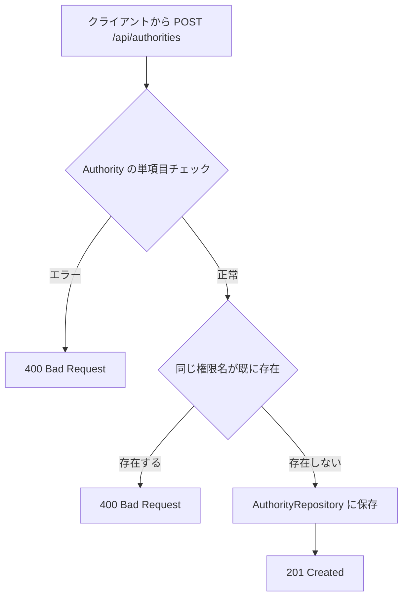

# 【JHipsterサンプルアプリ】サービス詳細設計書_権限管理

## 改版履歴

| **版数（Ver）** | **版数（Rev）** | **改版日付** | **改版シート** | **改版内容** | **担当者** | **確認者** |
| --- | --- | --- | --- | --- | --- | --- |
| 1.0 |  | 2026/11/23 |  | 初版作成 |  |  |

---

## 目次

| サブシステム名(ID) | 機能ID | 機能日本語名 | 処理名 | 処理種別 |
| --- | --- | --- | --- | --- |
| JHipsterサンプルアプリ | AuthorityResource | 権限管理 |  | 検索・登録・削除 |

目次

| 項番 | シート名 |
| --- | --- |
| 1 | 処理概要、処理フロー図 |
| 2 | 1　対象クラス |
| 3 | 2　API定義 |
| 4 | 3　単項目チェック |
| 5 | 4　相関項目チェック |
| 6 | 5　依存クラス |
| 7 | 6　処理詳細（POST /api/authorities） |
| 8 | 7　処理詳細（GET /api/authorities） |
| 9 | 8　処理詳細（GET /api/authorities/{id}） |
| 10 | 9　処理詳細（DELETE /api/authorities/{id}） |
| 11 | 10　エラー一覧 |

---

## 処理概要、処理フロー図

| サブシステム名(ID) | 機能ID | 機能日本語名 | 処理名 | 処理種別 |
| --- | --- | --- | --- | --- |
| JHipsterサンプルアプリ | AuthorityResource | 権限管理 |  | 検索・登録・削除 |

### 処理概要

| ・ | 管理者が、権限（`ROLE_ADMIN`、`ROLE_USER` 等）を検索、登録、削除する。 |
| --- | --- |

コール元に対する補足説明

フロントエンド（別リポジトリ）が HTTP で呼び出す。全エンドポイントに管理者権限 `ROLE_ADMIN` が必要である。本機能にはサービスクラスがなく、リソースクラスがリポジトリを直接使う。

処理フロー図「権限登録（POST /api/authorities）」

---

## 1　対象クラス

| サブシステム名(ID) | 機能ID | 機能日本語名 | 処理名 | 処理種別 |
| --- | --- | --- | --- | --- |
| JHipsterサンプルアプリ | AuthorityResource | 権限管理 | 対象クラス | 検索・登録・削除 |

### 処理詳細

| No | クラス | ファイルパス（リポジトリルート基準） | 役割 |
| --- | --- | --- | --- |
| 1 | `AuthorityResource` | `src/main/java/io/github/jhipster/sample/web/rest/AuthorityResource.java` | 権限管理のエンドポイント |
| 2 | `Authority` | `src/main/java/io/github/jhipster/sample/domain/Authority.java` | 権限のエンティティ。リクエスト・応答の本文としても使う |
| 3 | `AuthorityRepository` | `src/main/java/io/github/jhipster/sample/repository/AuthorityRepository.java` | 権限テーブルへのアクセス |
| 4 | `BadRequestAlertException` | `src/main/java/io/github/jhipster/sample/web/rest/errors/BadRequestAlertException.java` | 重複エラー |

---

## 2　API定義

| サブシステム名(ID) | 機能ID | 機能日本語名 | 処理名 | 処理種別 |
| --- | --- | --- | --- | --- |
| JHipsterサンプルアプリ | AuthorityResource | 権限管理 | API定義 | 検索・登録・削除 |

### 処理詳細

| No | HTTPメソッド | URL | リソースクラス | メソッド | 認可 | リクエスト | 応答本文 | 正常時ステータス | トランザクション |
| --- | --- | --- | --- | --- | --- | --- | --- | --- | --- |
| 1 | POST | `/api/authorities` | AuthorityResource | `createAuthority` | ROLE_ADMIN | 本文 `Authority`（JSON） | `Authority` | 201 | リソースクラスがトランザクションを管理する（クラスレベルの `@Transactional(rollbackFor = Exception.class)`） |
| 2 | GET | `/api/authorities` | AuthorityResource | `getAllAuthorities` | ROLE_ADMIN | なし | `Authority` の配列 | 200 | リソースクラスがトランザクションを管理する（クラスレベルの `@Transactional(rollbackFor = Exception.class)`） |
| 3 | GET | `/api/authorities/{id}` | AuthorityResource | `getAuthority` | ROLE_ADMIN | パス変数 `id`（権限名） | `Authority` | 200 | リソースクラスがトランザクションを管理する（クラスレベルの `@Transactional(rollbackFor = Exception.class)`） |
| 4 | DELETE | `/api/authorities/{id}` | AuthorityResource | `deleteAuthority` | ROLE_ADMIN | パス変数 `id`（権限名） | なし | 204 | リソースクラスがトランザクションを管理する（クラスレベルの `@Transactional(rollbackFor = Exception.class)`） |

リソースクラスに `@Transactional(rollbackFor = Exception.class)` を付与しており、全メソッドがトランザクションの中で実行される。

リクエスト・応答の本文は DTO ではなくエンティティ `Authority` を直接使う。JSON に含まれる項目は `name` のみである（`id` と `new` は `@JsonIgnoreProperties` で除外）。

---

## 3　単項目チェック

| サブシステム名(ID) | 機能ID | 機能日本語名 | 処理名 | 処理種別 |
| --- | --- | --- | --- | --- |
| JHipsterサンプルアプリ | AuthorityResource | 権限管理 | 単項目チェック | 検索・登録・削除 |

### 処理概要

リクエストデータ部の単項目チェックを実施する。

### 処理詳細

`POST /api/authorities` のみが対象である。チェックは `Authority` エンティティの Bean Validation アノテーションで行う。

| No | 項目 | 型 | 必須 | 桁数 | アノテーション | 備考 |
| --- | --- | --- | --- | --- | --- | --- |
| 1 | `name` | String | ○ | 50 以内 | `@NotNull`、`@Size(max = 50)` | 権限名（主キー） |

チェックエラーの場合、業務エラーと返す。

---

## 4　相関項目チェック

| サブシステム名(ID) | 機能ID | 機能日本語名 | 処理名 | 処理種別 |
| --- | --- | --- | --- | --- |
| JHipsterサンプルアプリ | AuthorityResource | 権限管理 | 相関項目チェック | 検索・登録・削除 |

### 処理概要

権限名の一意性をチェックする。

### 処理詳細

#### １）権限名の重複チェック（POST）

| 項番 | 取得テーブル名 | 取得メソッド | 取得条件 |
| --- | --- | --- | --- |
| 1 | `jhi_authority` | `AuthorityRepository#existsById` | `jhi_authority.name` ＝ リクエスト本文．`name` |

結果判定

| 検索結果 | 正常/WARN/エラー | 応答 | 備考欄 |
| --- | --- | --- | --- |
| なし | 正常 | － | 登録を続行する |
| あり | 業務エラー | 400 | `BadRequestAlertException("authority already exists", "adminAuthority", "idexists")` をスローする |

---

## 5　依存クラス

| サブシステム名(ID) | 機能ID | 機能日本語名 | 処理名 | 処理種別 |
| --- | --- | --- | --- | --- |
| JHipsterサンプルアプリ | AuthorityResource | 権限管理 | 依存クラス | 検索・登録・削除 |

### 処理概要

コンストラクタインジェクションで、本クラスが使う次の Bean を注入する。

### 処理詳細

| No | クラス | フィールド | 用途 |
| --- | --- | --- | --- |
| 1 | `AuthorityRepository` | `authorityRepository` | 権限の検索、保存、削除 |

`@Value("${jhipster.clientApp.name:jhipsterSampleApplication}")` で読み込む `applicationName` は、アラートヘッダの名前に使う。定数 `ENTITY_NAME` は `adminAuthority` であり、アラートのメッセージキーとエラーの `params` に使う。

`AuthorityRepository` の `save`、`existsById`、`deleteById` は、`JpaRepository` から継承したメソッドである。リポジトリのインターフェースには宣言がない。

---

## 6　処理詳細（POST /api/authorities）

| サブシステム名(ID) | 機能ID | 機能日本語名 | 処理名 | 処理種別 |
| --- | --- | --- | --- | --- |
| JHipsterサンプルアプリ | AuthorityResource | 権限管理 | createAuthority | 登録 |

### 処理概要

権限を新規登録する。

### 処理詳細

対象メソッドは `AuthorityResource#createAuthority(@Valid @RequestBody Authority authority)` である。

#### １）重複をチェックする。

「4　相関項目チェック」のとおり。

#### ２）保存する。

`AuthorityRepository#save(authority)` で保存する。

#### ３）応答を返す。

| 項目 | 内容 |
| --- | --- |
| ステータス | 201 |
| ヘッダ | `Location: /api/authorities/{name}`、`X-jhipsterSampleApplicationApp-alert: adminAuthority.created`、`X-jhipsterSampleApplicationApp-params: {name}` |
| 応答本文 | 登録した `Authority` の JSON |

---

## 7　処理詳細（GET /api/authorities）

| サブシステム名(ID) | 機能ID | 機能日本語名 | 処理名 | 処理種別 |
| --- | --- | --- | --- | --- |
| JHipsterサンプルアプリ | AuthorityResource | 権限管理 | getAllAuthorities | 検索 |

### 処理概要

全権限を検索する。

### 処理詳細

対象メソッドは `AuthorityResource#getAllAuthorities()` である。`AuthorityRepository#findAll()` の結果をそのまま返す。ページングと抽出条件はない。

| 項目 | 内容 |
| --- | --- |
| ステータス | 200 |
| 応答本文 | `Authority` の配列（0 件の場合は空配列） |

---

## 8　処理詳細（GET /api/authorities/{id}）

| サブシステム名(ID) | 機能ID | 機能日本語名 | 処理名 | 処理種別 |
| --- | --- | --- | --- | --- |
| JHipsterサンプルアプリ | AuthorityResource | 権限管理 | getAuthority | 検索 |

### 処理概要

権限名を指定して検索する。

### 処理詳細

対象メソッドは `AuthorityResource#getAuthority(@PathVariable("id") String id)` である。パス変数名は `id` であるが、値は権限名（主キー `name`）である。

`AuthorityRepository#findById(id)` で検索し、`ResponseUtil#wrapOrNotFound` で結果を応答に変換する。

| 条件 | ステータス | 応答本文 |
| --- | --- | --- |
| 該当あり | 200 | `Authority` |
| 該当なし | 404 | Problem Details |

---

## 9　処理詳細（DELETE /api/authorities/{id}）

| サブシステム名(ID) | 機能ID | 機能日本語名 | 処理名 | 処理種別 |
| --- | --- | --- | --- | --- |
| JHipsterサンプルアプリ | AuthorityResource | 権限管理 | deleteAuthority | 削除 |

### 処理概要

権限名を指定して削除する。

### 処理詳細

対象メソッドは `AuthorityResource#deleteAuthority(@PathVariable("id") String id)` である。

#### １）削除する。

`AuthorityRepository#deleteById(id)` で削除する。

#### ２）応答を返す。

ステータス 204、応答本文なし。ヘッダ `X-jhipsterSampleApplicationApp-alert: adminAuthority.deleted`、`X-jhipsterSampleApplicationApp-params: {id}` を返す。

存在しない権限名を指定した場合も 204 となる。ユーザに付与されている権限を削除しようとすると、外部キー制約 `fk_authority_name`（`jhi_user_authority.authority_name`）に反するため 500 となる（動作確認済み。2026/11/24）。

---

## 10　エラー一覧

| サブシステム名(ID) | 機能ID | 機能日本語名 | 処理名 | 処理種別 |
| --- | --- | --- | --- | --- |
| JHipsterサンプルアプリ | AuthorityResource | 権限管理 | エラー一覧 | 検索・登録・削除 |

### 処理詳細

エラー応答の本文は RFC 7807（Problem Details）形式である。変換規則は「01_共通仕様書 例外処理設計書」を参照。

| No | HTTPメソッド | 発生条件 | ステータス | `type` | `message` | 根拠 |
| --- | --- | --- | --- | --- | --- | --- |
| 1 | POST | `Authority` の単項目チェックエラー | 400 | `constraint-violation` | `error.validation` | コード（`@Valid`） |
| 2 | POST | 同じ権限名が既に存在 | 400 | `problem-with-message` | `error.idexists` | `AuthorityResourceIT#createAuthorityWithExistingId` |
| 3 | GET（一件） | 指定した権限が存在しない | 404 | `problem-with-message` | `error.http.404` | `AuthorityResourceIT#getNonExistingAuthority` |
| 4 | 全エンドポイント | 未認証、または JWT が無効 | 401 | － | 本文なし | コード（`SecurityConfiguration`） |
| 5 | 全エンドポイント | `ROLE_ADMIN` 以外の認証済みユーザ | 403 | `problem-with-message` | `error.http.403` | 動作確認（2026/11/24。`detail` は `Access Denied`）。根拠となるコードは `@PreAuthorize`。同種の変換は `ExceptionTranslatorIT#testAccessDenied` が確認 |
| 6 | DELETE | ユーザに付与されている権限を削除 | 500 | `problem-with-message` | `error.http.500` | 動作確認（2026/11/24。`DataIntegrityViolationException`）。権限は削除されない |

No 5 は、URL `/api/authorities` が `SecurityConfiguration` 上は「認証済み」で許可されているため、メソッドセキュリティの `@PreAuthorize` が拒否するものである。

---
