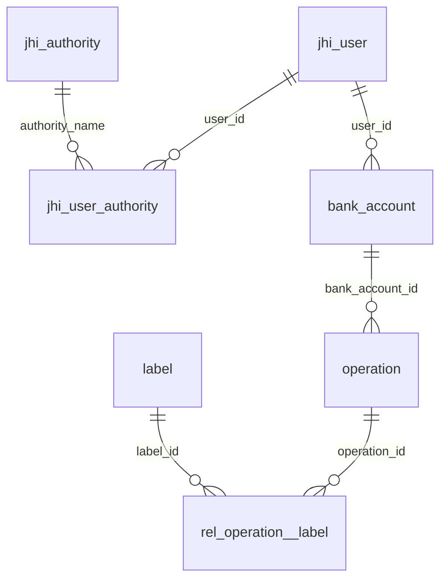

# 【JHipsterサンプルアプリ】テーブル一覧

## 改版履歴

| **版数** | **改版日付** | **改版内容** | **担当者** | **確認者** |
| --- | --- | --- | --- | --- |
| 1.0 | 2026/11/23 | 初版作成 |  |  |

---

## テーブル一覧

本リポジトリのエンティティは、テーブルと 1 対 1 で対応する（テーブルの行を表すオブジェクト）。各テーブルの項目定義は「05_TblDto仕様書」内の個別の設計書を参照。

| **NO** | **テーブル名** | **日本語名** | **主キー** | **エンティティクラス** | **リポジトリ** | **項目定義書** |
| --- | --- | --- | --- | --- | --- | --- |
| 1 | `jhi_user` | ユーザ | `id` | `User` | `UserRepository` | [_jhi_user_TblDto](./【JHipsterサンプルアプリ】_jhi_user_TblDto.md) |
| 2 | `jhi_authority` | 権限 | `name` | `Authority` | `AuthorityRepository` | [_jhi_authority_TblDto](./【JHipsterサンプルアプリ】_jhi_authority_TblDto.md) |
| 3 | `jhi_user_authority` | ユーザ・権限関連 | `user_id`、`authority_name` | なし（`User.authorities` の結合テーブル） | なし | [_jhi_user_authority_TblDto](./【JHipsterサンプルアプリ】_jhi_user_authority_TblDto.md) |
| 4 | `bank_account` | 銀行口座 | `id` | `BankAccount` | `BankAccountRepository` | [_bank_account_TblDto](./【JHipsterサンプルアプリ】_bank_account_TblDto.md) |
| 5 | `operation` | 取引 | `id` | `Operation` | `OperationRepository` | [_operation_TblDto](./【JHipsterサンプルアプリ】_operation_TblDto.md) |
| 6 | `label` | ラベル | `id` | `Label` | `LabelRepository` | [_label_TblDto](./【JHipsterサンプルアプリ】_label_TblDto.md) |
| 7 | `rel_operation__label` | 取引・ラベル関連 | `operation_id`、`label_id` | なし（`Operation.labels` の結合テーブル） | なし | [_rel_operation__label_TblDto](./【JHipsterサンプルアプリ】_rel_operation__label_TblDto.md) |

エンティティを持たないテーブルは次のとおりである。

| **NO** | **テーブル名** | **用途** | **備考** |
| --- | --- | --- | --- |
| 1 | `jhi_date_time_wrapper` | 日時型のマッピングを確認するテスト用のテーブル | Liquibase のコンテキスト `test` のときだけ作成する。テストクラス `DateTimeWrapper`、`DateTimeWrapperRepository` だけが使う |
| 2 | Liquibase の管理テーブル | 適用済みの変更セットの管理 | アプリケーションのコードからは使わない。「07_DBマイグレーション仕様書」を参照 |

---

## テーブル間の関連

| **NO** | **関連名（主側 → 従側）** | **多重度** | **外部キー** | **従側のカラム** | **主側のカラム** | **NULL** |
| --- | --- | --- | --- | --- | --- | --- |
| 1 | ユーザ → ユーザ・権限関連 | 1 対多 | `fk_user_id` | `jhi_user_authority.user_id` | `jhi_user.id` | NOT NULL |
| 2 | 権限 → ユーザ・権限関連 | 1 対多 | `fk_authority_name` | `jhi_user_authority.authority_name` | `jhi_authority.name` | NOT NULL |
| 3 | ユーザ → 銀行口座 | 1 対多 | `fk_bank_account__user_id` | `bank_account.user_id` | `jhi_user.id` | NULL 可 |
| 4 | 銀行口座 → 取引 | 1 対多 | `fk_operation__bank_account_id` | `operation.bank_account_id` | `bank_account.id` | NULL 可 |
| 5 | 取引 → 取引・ラベル関連 | 1 対多 | `fk_rel_operation__label__operation_id` | `rel_operation__label.operation_id` | `operation.id` | NOT NULL |
| 6 | ラベル → 取引・ラベル関連 | 1 対多 | `fk_rel_operation__label__label_id` | `rel_operation__label.label_id` | `label.id` | NOT NULL |

エンティティ側の対応は次のとおりである。

| **NO** | **エンティティ** | **プロパティ** | **関連の種類** | **相手のエンティティ** | **読み込み** |
| --- | --- | --- | --- | --- | --- |
| 1 | `User` | `authorities` | 多対多（所有側、結合テーブル `jhi_user_authority`） | `Authority` | 遅延 |
| 2 | `BankAccount` | `user` | 多対 1 | `User` | 遅延 |
| 3 | `BankAccount` | `operations` | 1 対多（`mappedBy = "bankAccount"`） | `Operation` | 遅延 |
| 4 | `Operation` | `bankAccount` | 多対 1 | `BankAccount` | 遅延 |
| 5 | `Operation` | `labels` | 多対多（所有側、結合テーブル `rel_operation__label`） | `Label` | 遅延 |
| 6 | `Label` | `operations` | 多対多（被所有側、`mappedBy = "labels"`） | `Operation` | 遅延 |

全ての関連を遅延読み込み（`FetchType.LAZY`）で定義しており、カスケード削除は設定していない。

---
